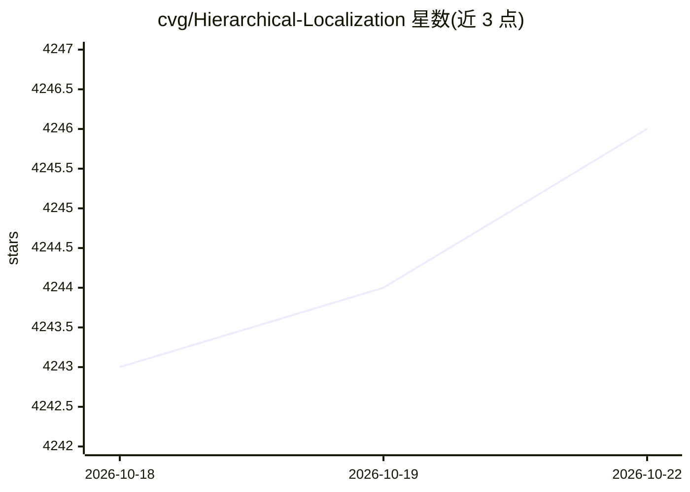

# cvg/Hierarchical-Localization

⭐ 4,246 · Python · Apache-2.0 · 推送 2025-12-10 · [GitHub](https://github.com/cvg/Hierarchical-Localization) · 组织维护

**分层视觉定位工具箱：结合图像检索与特征匹配的 6-DoF 定位**

hloc 是用于 6-DoF 视觉定位的模块化工具箱，实现结合图像检索与特征匹配的分层定位方法。用户可用它复现多个室内外视觉定位基准的结果、用 SuperPoint+SuperGlue 运行 Structure-from-Motion 在自有数据上定位、评估自定义局部特征或检索方法，并实现和调试新的定位流水线。支持多种特征提取器（SuperPoint、DISK、D2-Net、SIFT、R2D2）、匹配器（SuperGlue、LightGlue、LoFTR 等）与检索模型（NetVLAD、AP-GeM 等）。通过 git clone + pip install -e 安装，自 v1.3 起依赖 pycolmap 而无需单独安装 COLMAP，另提供 Docker 镜像与 Colab 演示笔记本。

## 筛选速览

| 维度 | 判定 | 备注 |
|---|---|---|
| AI 角色 | `ai-native` | 本体是模型或模型工具 |
| 许可风险 | `permissive` | Apache-2.0 |
| 部署形态 | `self-host` | docker 或自建部署 |
| 模型依赖 | — | README 未给出锁定关系 |
| 硬件要求 | — | 无带数字的原话,不猜 |
| 安装摩擦 | `low` | 无编译、无系统依赖或容器化 |
| 成熟度 | — | 结构信号不足 |

## 能力要点

- 分层定位流水线：特征提取→SfM 建图→检索→匹配→定位
- 支持多种局部特征提取器、匹配器与图像检索模型
- 通过继承 BaseModel 接口接入自定义特征/匹配器/检索方法
- 提供 Aachen、InLoc、7-Scenes 等多数据集的现成流水线脚本

## 适用场景

- 在室内外基准数据集上复现与评估视觉定位结果
- 用自己的图片集做 SfM 重建并定位新查询图像
- 评估自己开发的局部特征或图像检索方法
- 开发和调试新的视觉定位流水线

## 场景标签

 · 领域:计算机视觉/定位与重建

## 证据(README 行号)

> L3: This is `hloc`, a modular toolbox for state-of-the-art 6-DoF visual localization. It implements Hierarchical Localiz
> L8: - Run Structure-from-Motion with SuperPoint+SuperGlue to localize with your own datasets

## 星数曲线

2026-10-18 4,243 → 2026-10-22 4,246（+3）

---
*卡片 v1 · prompt 1.4 · 生成 2026-10-20 · 置信度 mid · 依据 README sha `3364cd2c0da5` · [字段定义](../../DATASET.md)*
