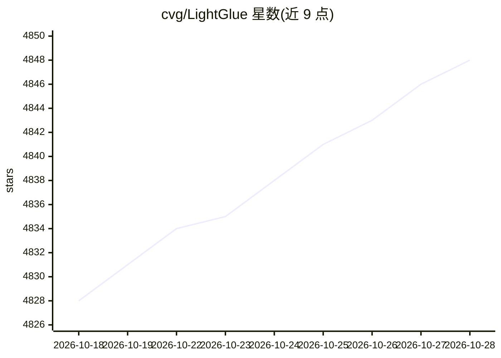

# cvg/LightGlue

⭐ 4,849 · Python · Apache-2.0 · 推送 2026-10-25 · [GitHub](https://github.com/cvg/LightGlue) · 组织维护

**图像间稀疏局部特征匹配的深度神经网络（ICCV 2023）**

LightGlue 是匹配图像对稀疏局部特征的深度神经网络：输入每幅图像的关键点与描述子，返回对应点索引；采用深度（层数早停）与宽度（点剪枝）自适应剪枝机制调节计算量。随 SuperPoint、DISK、ALIKED、SIFT 特征发布预训练权重；训练与评测代码在 glue-factory 库中。以 pip 源码方式安装，提供 demo notebook、基准脚本与 Colab 演示；已进入 Hugging Face Transformers，可 pip 安装 transformers 后推理。限制：SuperPoint 权重与推理文件遵循不同的限制性许可。

## 筛选速览

| 维度 | 判定 | 备注 |
|---|---|---|
| AI 角色 | `ai-native` | 本体是模型或模型工具 |
| 许可风险 | `permissive` | Apache-2.0 |
| 部署形态 | `library` | 以包/库形式分发 |
| 模型依赖 | local-ok | 支持本地模型 |
| 硬件要求 | — | 无带数字的原话,不猜 |
| 安装摩擦 | `medium` | 含编译或系统依赖之一 |
| 成熟度 | — | 结构信号不足 |

## 能力要点

- 输入关键点/描述子，输出图像对对应点索引
- 深度与宽度两级自适应剪枝机制，层数与关键点数可按图像对调整
- 发布 SuperPoint/DISK/ALIKED/SIFT 四种特征的预训练权重
- 支持 FlashAttention、混合精度与 torch>=2.0 编译加速

## 适用场景

- 在两幅图像间建立特征点对应关系（如位姿估计、SfM 前端）
- 与其他特征提取器组合做图像匹配流水线
- 在自有数据集上训练或评测匹配器（经 glue-factory）

## 场景标签

 · 领域:计算机视觉/图像匹配

## 证据(README 行号)

> L18:  LightGlue is a deep neural network that matches sparse local features across image pairs. An adaptive mechanism ma
> L22: This repository hosts the inference code of LightGlue, a lightweight feature matcher with high accuracy and blazing

## 星数曲线

2026-10-18 4,828 → 2026-10-28 4,848（+20）

---
*卡片 v1 · prompt 1.4 · 生成 2026-10-20 · 置信度 high · 依据 README sha `995c26eb47a8` · [字段定义](../../DATASET.md)*
