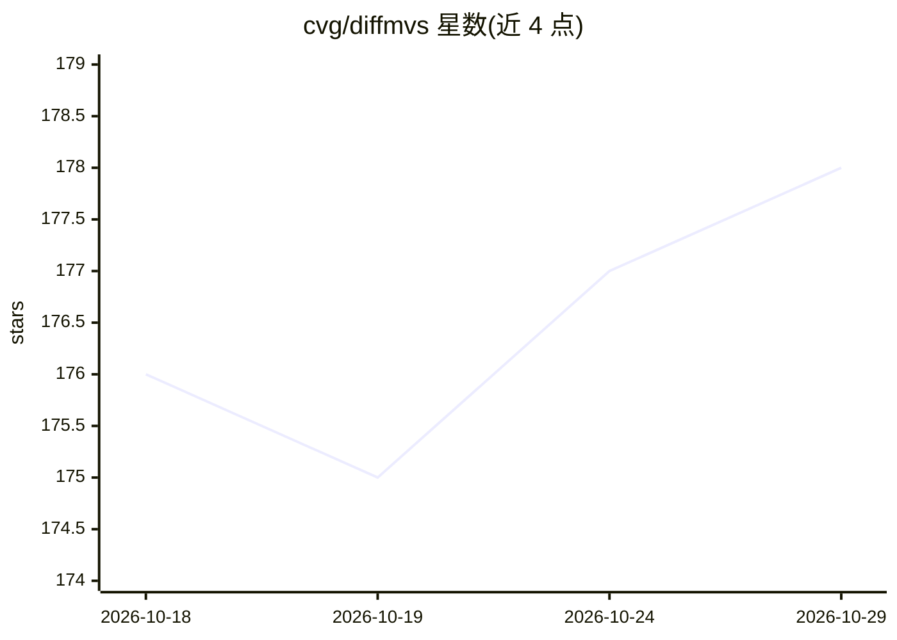

# cvg/diffmvs

⭐ 178 · Python · Apache-2.0 · 推送 2025-12-24 · [GitHub](https://github.com/cvg/diffmvs) · 组织维护

**基于扩散模型的多视图立体重建方法（DiffMVS/CasDiffMVS）**

T-PAMI 2025 论文官方实现：提出 DiffMVS 与 CasDiffMVS 两种多视图立体（MVS）方法，先用网络估计粗深度图，再用条件扩散模型对其进行细化，扩散模型学习深度先验并借助随机噪声避免局部最优；从粗深度图出发而非纯随机噪声，可减少采样步数并提升对随机种子的稳定性。支持下载预训练权重，对自有图像先经 VGGT 或 COLMAP 做稀疏重建与数据格式转换，再估计深度图并融合为点云；提供 DTU、Tanks & Temples、ETH3D 基准复现脚本与训练脚本。

## 筛选速览

| 维度 | 判定 | 备注 |
|---|---|---|
| AI 角色 | `ai-native` | 本体是模型或模型工具 |
| 许可风险 | `permissive` | Apache-2.0 |
| 部署形态 | `library` | 以包/库形式分发 |
| 模型依赖 | — | README 未给出锁定关系 |
| 硬件要求 | — | 无带数字的原话,不猜 |
| 安装摩擦 | `low` | 无编译、无系统依赖或容器化 |
| 成熟度 | — | 结构信号不足 |

## 能力要点

- 条件扩散模型细化粗深度图的 MVS 重建流程
- 提供 DiffMVS 与 CasDiffMVS 预训练权重（含 2025 年更新的 BlendedMVG 微调版本）
- 支持 VGGT 与 COLMAP 两种相机位姿估计前端
- 提供 DTU/Tanks & Temples/ETH3D 基准评测与训练脚本

## 适用场景

- 用自己的多视图图像做稠密三维重建（深度估计+点云融合）
- 在 DTU、Tanks & Temples、ETH3D 基准上复现论文结果
- 作为 MVS 研究的基线方法进行训练与改进

## 场景标签

`图像视频处理` · 领域:感知与多模态

## 证据(README 行号)

> L1: Lightweight and Accurate Multi-View Stereo with Confidence-Aware Diffusion Model
> L26: Specifically, we estimate a coarse initial depth map and refine it with a conditional diffusion model.
> L27: Diffusion model learns depth prior and uses random noise to avoid local minima.

## 星数曲线

2026-10-18 176 → 2026-10-29 178（+2）

---
*卡片 v1 · prompt 1.4 · 生成 2026-10-22 · 置信度 mid · 依据 README sha `d00716943681` · [字段定义](../../DATASET.md)*
