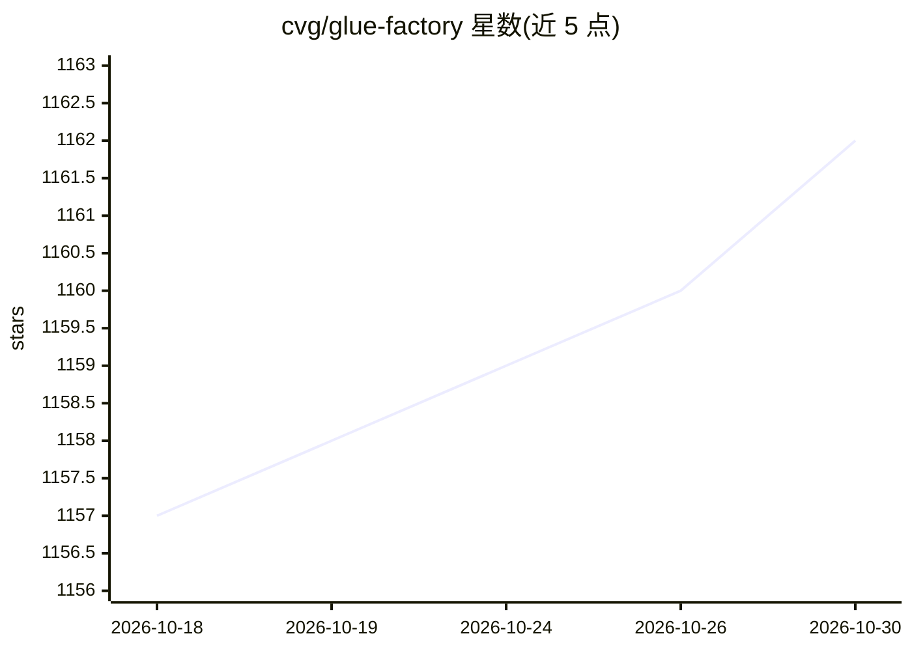

# cvg/glue-factory

⭐ 1,162 · Python · Apache-2.0 · 推送 2026-07-20 · [GitHub](https://github.com/cvg/glue-factory) · 组织维护

**局部特征检测与匹配模型的训练和评测库**

CVG 维护的深度学习库，用于训练和评测提取与匹配局部视觉特征（点与线）的神经网络。可复现 LightGlue、GlueStick（ICCV 2023）等模型的训练，支持在自有特征（SuperPoint/SIFT/ALIKED/DISK 等）上训练匹配器，并在 HPatches、MegaDepth-1500、Scannet-1500、ETH3D 等基准上评测。模型与数据集自动下载；默认训练配置要求 2x 3090（24GB VRAM）与 PyTorch>=2.0，预训练数据集约需 450GB+420GB 磁盘。以源码 pip editable 方式安装，Apache-2.0 许可（第三方非兼容模型置于 gluefactory_nonfree）。

## 筛选速览

| 维度 | 判定 | 备注 |
|---|---|---|
| AI 角色 | `ai-native` | 本体是模型或模型工具 |
| 许可风险 | `permissive` | Apache-2.0 |
| 部署形态 | `library` | 以包/库形式分发 |
| 模型依赖 | — | README 未给出锁定关系 |
| 硬件要求 | — | 无带数字的原话,不猜 |
| 安装摩擦 | `low` | 无编译、无系统依赖或容器化 |
| 成熟度 | — | 结构信号不足 |

## 能力要点

- 复现 LightGlue/GlueStick 等模型的训练流程（两阶段：单应预训练+MegaDepth 微调）
- 支持 SuperPoint/SIFT/ALIKED/DISK 等特征提取器组合训练
- HPatches、MegaDepth-1500、Scannet-1500、ETH3D 基准评测与可视化检查工具
- 模型与数据集均带自动下载器

## 适用场景

- 复现论文中的点线匹配模型训练结果
- 用自己的局部特征训练 LightGlue 等匹配器
- 在标准基准上评测特征提取器与匹配器组合

## 场景标签

`模型训练` `模型评测` `图像视频处理` · 领域:评测与运维

## 证据(README 行号)

> L2: Glue Factory is CVG's library for training and evaluating deep neural network that extract and match local visual fe
> L3: - Reproduce the training of state-of-the-art models for point and line matching, like LightGlue and GlueStick (ICCV 

## 星数曲线

2026-10-18 1,157 → 2026-10-30 1,162（+5）

---
*卡片 v1 · prompt 1.4 · 生成 2026-10-21 · 置信度 high · 依据 README sha `5035c0490f2f` · [字段定义](../../DATASET.md)*
