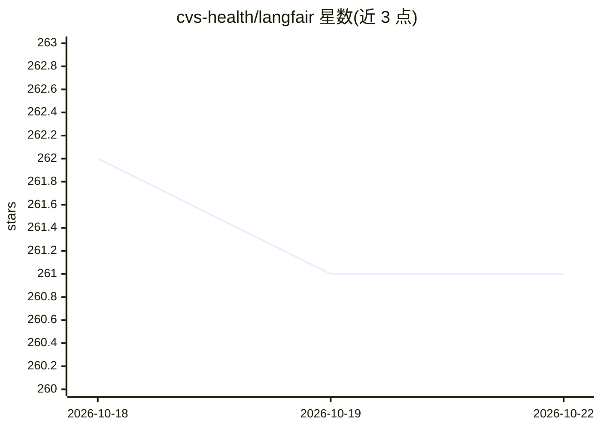

# cvs-health/langfair

⭐ 261 · Python · NOASSERTION · 推送 2026-09-11 · [GitHub](https://github.com/cvs-health/langfair) · [官网](https://cvs-health.github.io/langfair/) · 组织维护

**评估 LLM 用例偏见与公平性的 Python 库，供治理审计使用**

CVS Health 团队维护的 LLM 偏见与公平性评估库：采用 Bring Your Own Prompts 方式，用户提交用例专属提示词，通过 ResponseGenerator 生成 LLM 回复（需 LangChain LLM 对象，任意 LangChain LLM 类可用），再计算毒性、刻板印象、反事实公平性、推荐与分类公平性五类指标；也可用 AutoEval 两行代码完成全流程，或用 SelfEval 自带回复评估。另提供对抗性提示的红队评估。输出导向的指标无需访问模型内部状态。

## 筛选速览

| 维度 | 判定 | 备注 |
|---|---|---|
| AI 角色 | `ai-ecosystem` | LLM/agent 周边工具 |
| 许可风险 | `none` | NOASSERTION |
| 部署形态 | `library` | 以包/库形式分发 |
| 模型依赖 | — | README 未给出锁定关系 |
| 硬件要求 | — | 无带数字的原话,不猜 |
| 安装摩擦 | `medium` | 含编译或系统依赖之一 |
| 成熟度 | — | 结构信号不足 |

## 能力要点

- BYOP 方式按用例专属提示词做偏见与公平性评估
- 覆盖毒性、刻板印象、反事实、推荐、分类五类公平性指标
- AutoEval 两行代码完成全流程，SelfEval 支持自带回复评估
- 提供对抗性提示的红队评估（AdversarialGenerator）

## 适用场景

- 对文本生成/摘要类 LLM 用例做治理审计
- 评估分类或推荐系统用例中的公平性指标
- 红队测试评估最坏情形毒性与反事实输出

## 场景标签

 · 领域:LLM 评测/负责任 AI

## 证据(README 行号)

> L8: LangFair is a comprehensive Python library designed for conducting bias and fairness assessments of large language m
> L20: LangFair addresses this gap by adopting a Bring Your Own Prompts (BYOP) approach, allowing users to tailor bias and
> L39: To generate responses, we can use LangFair's `ResponseGenerator` class. First, we must create a `langchain` LLM obj

## 星数曲线

2026-10-18 262 → 2026-10-22 261（-1）

---
*卡片 v1 · prompt 1.4 · 生成 2026-10-22 · 置信度 high · 依据 README sha `3d81f278b5d3` · [字段定义](../../DATASET.md)*
