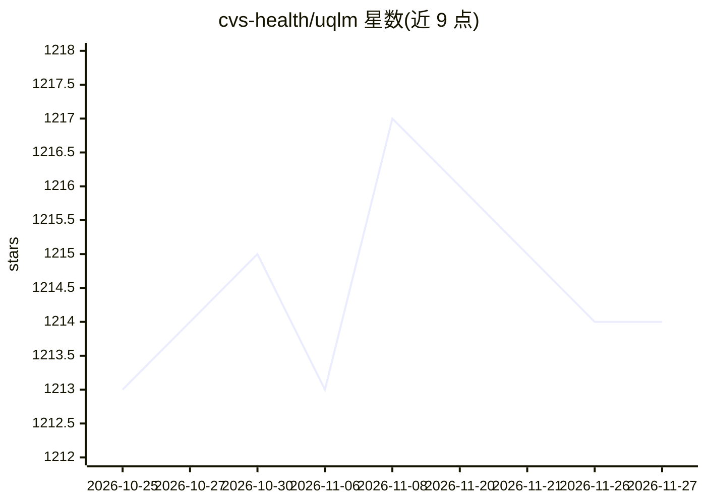

# cvs-health/uqlm

⭐ 1,214 · Python · Apache-2.0 · 推送 2026-11-08 · [GitHub](https://github.com/cvs-health/uqlm) · [官网](https://cvs-health.github.io/uqlm/latest/index.html) · 组织维护

**开发者用的 LLM 幻觉检测库：为输出打置信度分**

UQLM 是一个 Python 库，基于不确定性量化技术检测 LLM 输出中的幻觉。提供五类响应级评分器：黑盒（多次生成一致性）、白盒（token 概率）、LLM-as-a-Judge、集成加权与长文本 claim 级评分，每类返回 0-1 置信度分数；另含 CodeGenUQ 接口在不执行代码的情况下预测生成代码的正确性，长文本评分器可按阈值删除低置信 claim 后重构响应。任何 LangChain Chat Model 均可接入，从 PyPI 安装，配套示例 notebook 与 API 文档，发表记录包括 JMLR、TMLR 与 EMNLP。

## 筛选速览

| 维度 | 判定 | 备注 |
|---|---|---|
| AI 角色 | `ai-ecosystem` | LLM/agent 周边工具 |
| 许可风险 | `permissive` | Apache-2.0 |
| 部署形态 | `library` | 以包/库形式分发 |
| 模型依赖 | local-ok | 支持本地模型 |
| 硬件要求 | — | 无带数字的原话,不猜 |
| 安装摩擦 | `low` | 无编译、无系统依赖或容器化 |
| 成熟度 | — | 结构信号不足 |

## 能力要点

- 五类评分器：黑盒、白盒、LLM-as-a-Judge、集成、长文本 claim 级
- 所有评分器返回 0-1 置信度分数，兼容任意 LangChain Chat Model
- CodeGenUQ 无需执行代码即可预测 LLM 生成代码的正确性
- 长文本评分器支持按 claim 置信度阈值重构响应

## 适用场景

- 为 RAG 或对话系统的 LLM 回答附加幻觉风险分数
- 对长文本生成做 claim 级检测并过滤低置信内容
- 在不执行代码的情况下评估 LLM 生成代码的正确性
- 基于标注数据训练监督式集成评分器

## 场景标签

`模型评测` · 领域:评测与运维

## 证据(README 行号)

> L22: UQLM is a Python library for detecting hallucinations in Large Language Model (LLM) outputs using state-of-the-art 
> L32: UQLM provides a suite of response-level scorers, each returning a confidence score between 0 and 1, where higher sc

## 星数曲线

2026-10-25 1,213 → 2026-11-27 1,214（+1）

---
*卡片 v1 · prompt 1.4 · 生成 2026-11-23 · 置信度 high · 依据 README sha `4326f0491f1f` · [字段定义](../../DATASET.md)*
