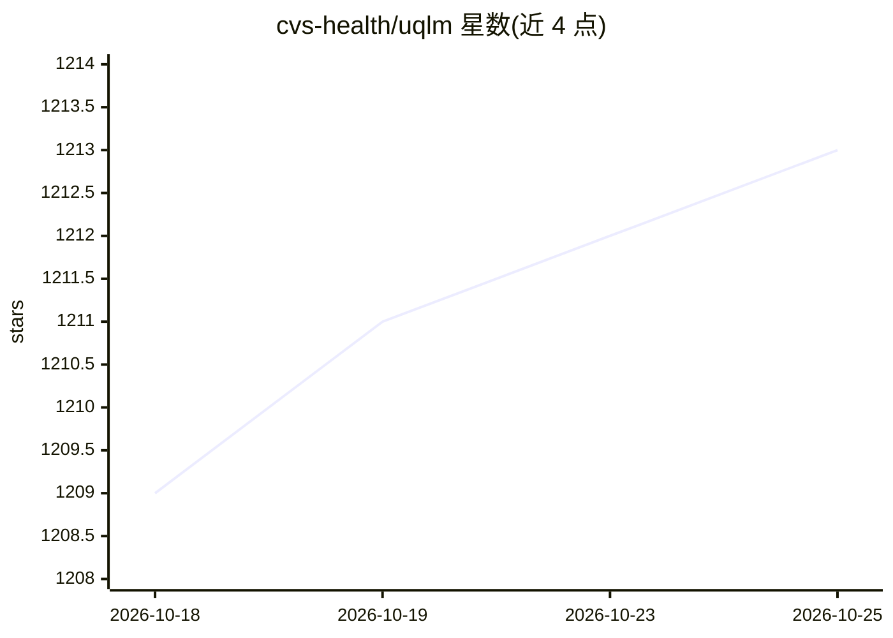

# cvs-health/uqlm

⭐ 1,213 · Python · Apache-2.0 · 推送 2026-10-13 · [GitHub](https://github.com/cvs-health/uqlm) · [官网](https://cvs-health.github.io/uqlm/latest/index.html) · 组织维护

**检测 LLM 输出幻觉的 Python 不确定性量化库**

面向开发者的幻觉检测库：对 LLM 回答输出 0-1 之间的响应级置信分数，分数越高表示出错或幻觉可能性越低。提供黑盒（多采样一致性）、白盒（token 概率）、LLM-as-a-Judge、集成与长文本声明级五类评分器，另有 CodeGenUQ 用于免执行预测 LLM 生成代码的功能正确性。通过任意 LangChain Chat Model 接入 LLM，白盒方法需要访问 token 概率。pip 安装，附示例 notebook，方法发表于 JMLR/TMLR/EMNLP。

## 筛选速览

| 维度 | 判定 | 备注 |
|---|---|---|
| AI 角色 | `ai-ecosystem` | LLM/agent 周边工具 |
| 许可风险 | `permissive` | Apache-2.0 |
| 部署形态 | `library` | 以包/库形式分发 |
| 模型依赖 | — | README 未给出锁定关系 |
| 硬件要求 | — | 无带数字的原话,不猜 |
| 安装摩擦 | `low` | 无编译、无系统依赖或容器化 |
| 成熟度 | — | 结构信号不足 |

## 能力要点

- 五类评分器：黑盒一致性、白盒 token 概率、LLM 评审、集成、长文本声明级
- CodeGenUQ 无需执行即可预测 LLM 生成代码的功能正确性
- 长文本场景支持按阈值剔除低置信声明并重构回答
- 可通过任意 LangChain Chat Model 接入 LLM

## 适用场景

- 给 LLM 应用输出的每条回答附加幻觉置信分数
- 长文本生成中过滤低置信声明以提高事实精度
- 在不执行代码的情况下预判 LLM 生成代码是否功能正确

## 场景标签

`LLM 可观测性` · 领域:评测与运维

## 证据(README 行号)

> L22: UQLM is a Python library for detecting hallucinations in Large Language Model (LLM) outputs using state-of-the-art 
> L32: UQLM provides a suite of response-level scorers, each returning a confidence score between 0 and 1, where higher sc

## 星数曲线

2026-10-18 1,209 → 2026-10-25 1,213（+4）

---
*卡片 v1 · prompt 1.4 · 生成 2026-10-21 · 置信度 high · 依据 README sha `c38e79f79f5c` · [字段定义](../../DATASET.md)*
