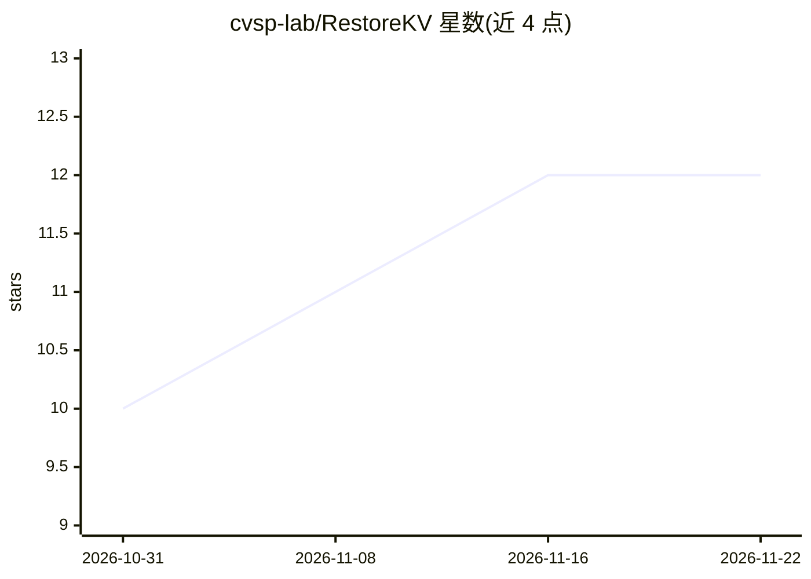

# cvsp-lab/RestoreKV

⭐ 12 · Python · MIT · 推送 2026-10-06 · [GitHub](https://github.com/cvsp-lab/RestoreKV) · [官网](https://paper.pnu-cvsp.com/RestoreKV/) · 组织维护

**给研究者在 KV 缓存压缩下恢复全缓存行为的 LoRA 恢复缓存方法实现**

论文 RestoreKV 的官方实现仓库：在 query-agnostic KV 缓存驱逐基础上，prefill 后用少量 restore token 经一次 LoRA 适配的 pass 读取全缓存，生成上下文条件化的 restore cache，后续解码时禁用适配器；通过自蒸馏训练，仅优化 0.4% 参数。仓库提供训练与评测代码（checkpoints/ 内含 6 个适配器），并已接入 NVIDIA KVPress 提供 HF 权重推理。代码为 MIT，训练数据为 CC BY-NC 4.0 研究用途。

## 筛选速览

| 维度 | 判定 | 备注 |
|---|---|---|
| AI 角色 | `ai-native` | 本体是模型或模型工具 |
| 许可风险 | `permissive` | MIT |
| 部署形态 | `desktop` | 安装包/桌面程序 |
| 模型依赖 | — | README 未给出锁定关系 |
| 硬件要求 | — | 无带数字的原话,不猜 |
| 安装摩擦 | `medium` | 含编译或系统依赖之一 |
| 成熟度 | — | 结构信号不足 |

## 能力要点

- LoRA 适配的单次 restore pass 生成上下文条件化 restore cache
- 自蒸馏训练，仅训练 0.4% 参数，无需任务特定调参
- 支持 Qwen3-4B/Qwen3-8B/Llama-3.1-8B 三种基座及 RestoreKV/RestoreKV+ 两类适配器
- 推理侧以 RestoreKVPress 形式集成于 NVIDIA KVPress

## 适用场景

- 复现论文中 KV 缓存压缩下的长上下文评测结果
- 在 KVPress 中对既有驱逐方法叠加恢复缓存做推理
- 训练自定义基座模型的 restore 适配器

## 场景标签

`微调` `模型评测` · 领域:评测与运维

## 证据(README 行号)

> L21: **RestoreKV** complements selection-based query-agnostic KV cache eviction with **learned restoration** under
> L45: - **2026-10** — 🧑‍💻 Full training & evaluation code released in this repository.
> L79: This repository contains the full **training** and **evaluation** code used in the paper.

## 星数曲线

2026-10-31 10 → 2026-11-22 12（+2）

---
*卡片 v1 · prompt 1.4 · 生成 2026-11-18 · 置信度 high · 依据 README sha `1df90bd25e63` · [字段定义](../../DATASET.md)*
