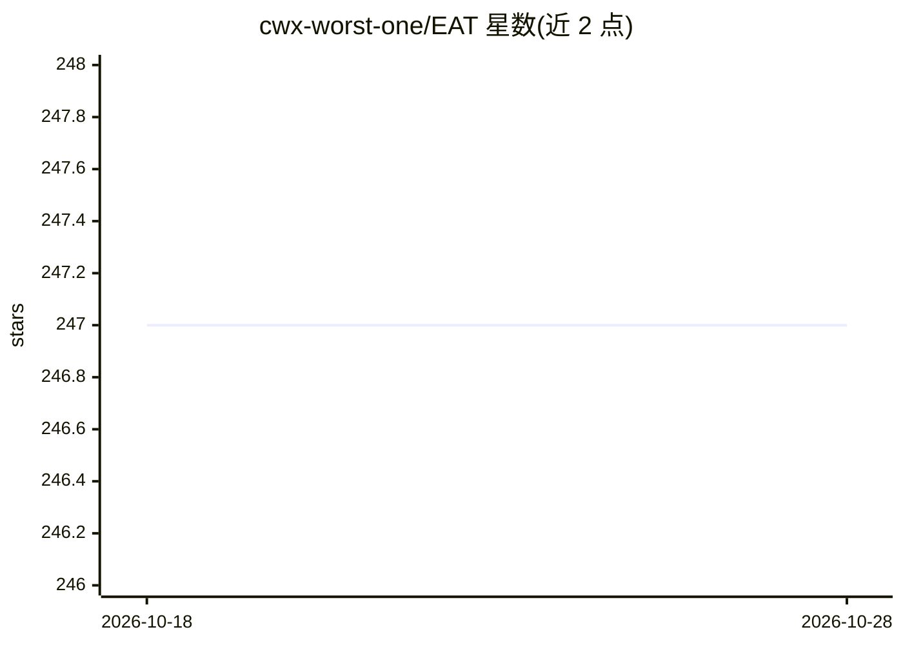

# cwx-worst-one/EAT

⭐ 247 · Python · MIT · 推送 2025-11-30 · [GitHub](https://github.com/cwx-worst-one/EAT) · 组织维护 · 中文 README

**音频自监督预训练模型（IJCAI 2024）：音频分类与特征提取**

I JCAI 2024 论文官方代码：基于高效 Audio Transformer 的自监督预训练模型 EAT，在 AudioSet AS-2M 上预训练，支持微调到 AS-20K、ESC-50、SPCv2 等音频分类任务，并提供特征提取、推理与评测脚本。提供 EAT-base（88M）与 EAT-large（309M）检查点，通过 Google Drive 供 Fairseq 继续训练、通过 Hugging Face 供直接推理；预训练/微调需手动安装 Fairseq，仅推理可免装。训练代码改编自 Audio-MAE 与 data2vec。AudioSet 原始音频因版权不随库分发，仅提供数据清单。目标用户为音频机器学习研究者与开发者。

## 筛选速览

| 维度 | 判定 | 备注 |
|---|---|---|
| AI 角色 | `ai-native` | 本体是模型或模型工具 |
| 许可风险 | `permissive` | MIT |
| 部署形态 | `library` | 以包/库形式分发 |
| 模型依赖 | — | README 未给出锁定关系 |
| 硬件要求 | — | 无带数字的原话,不猜 |
| 安装摩擦 | `low` | 无编译、无系统依赖或容器化 |
| 成熟度 | — | 结构信号不足 |

## 能力要点

- 提供 EAT-base/EAT-large 预训练与微调检查点（Google Drive 与 Hugging Face 双渠道）
- 支持变长音频的训练、特征提取、推理与评测
- 仅做特征提取或推理时无需安装 Fairseq（AutoModel.from_pretrained 直接加载）
- 提供预训练、微调、推理、评测完整脚本

## 适用场景

- 在 AudioSet/ESC-50 等数据集上做音频事件分类微调与评测
- 用 EAT 作为音频编码器提取特征
- 在自己的音频数据上继续自监督预训练

## 场景标签

`模型训练` `微调` · 领域:训练与推理

## 证据(README 行号)

> L18: EAT is an audio SSL model with high effectiveness and efficiency during self-supervised pre-training. You can find 
> L98: We use `finetuning.yaml` as the default configuration file for fine-tuning. To fine-tune the EAT model in different
> L127: Pre-training on AS-2M, EAT gains state-of-the-art (SOTA) performance on several audio and speech classification da

## 星数曲线

2026-10-18 247 → 2026-10-28 247（+0）

---
*卡片 v1 · prompt 1.4 · 生成 2026-10-22 · 置信度 high · 依据 README sha `94e5c530eb29` · [字段定义](../../DATASET.md)*
