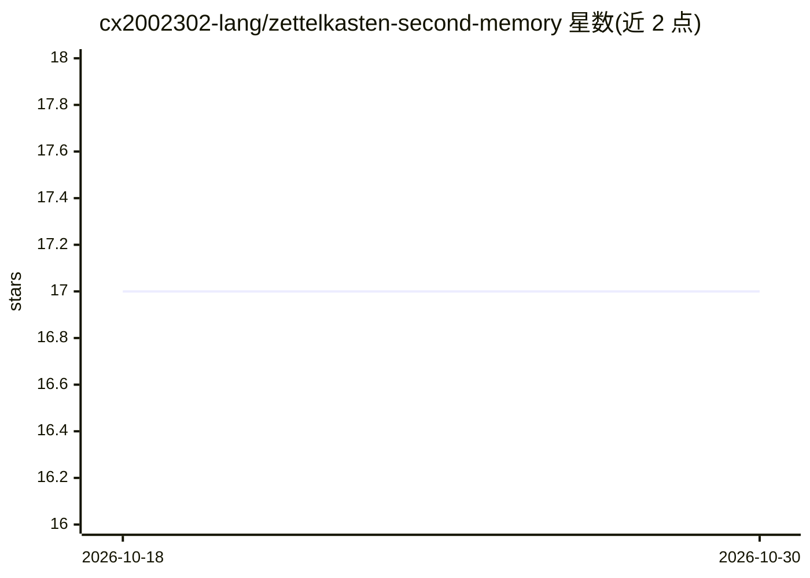

# cx2002302-lang/zettelkasten-second-memory

⭐ 17 · TypeScript · MIT · 推送 2026-07-19 · [GitHub](https://github.com/cx2002302-lang/zettelkasten-second-memory) · [官网](https://github.com/cx2002302-lang/zettelkasten-second-memory/releases) · 个人维护 · 中文 README

**把 AI 对话沉淀为 Zettelkasten 知识库的 OpenClaw/Hermes 插件**

面向 OpenClaw（2026.4/2026.6+）与 Hermes Agent 的插件，通过 MCP 工具让 AI agent 在对话中自动创建原子笔记、建立双向链接并检索知识：支持 11 种语义链接类型、SQLite FTS5 全文搜索（含中文分词）、CEQRC 知识蒸馏管线、PageRank 知识重要性评分、僵尸笔记检测与自动归档。所有笔记以 Markdown 存储，数据本地化。提供 24 个 MCP 工具与 openclaw zk 系列 CLI 命令；Hermes 支持为实验性（MCP HTTP 桥接）。需 Node.js >= 22.14.0（内置 node:sqlite），git clone 源码安装。

## 筛选速览

| 维度 | 判定 | 备注 |
|---|---|---|
| AI 角色 | `ai-ecosystem` | LLM/agent 周边工具 |
| 许可风险 | `permissive` | MIT |
| 部署形态 | `None` |  |
| 模型依赖 | — | README 未给出锁定关系 |
| 硬件要求 | — | 无带数字的原话,不猜 |
| 安装摩擦 | `low` | 无编译、无系统依赖或容器化 |
| 成熟度 | `idea` | |

## 能力要点

- 原子笔记 + 11 种语义链接类型构成知识图谱
- 24 个 MCP 工具供 AI agent 读写笔记与执行蒸馏
- SQLite FTS5 + LIKE 双引擎全文搜索，支持中文分词
- 僵尸笔记检测、Glow 排序（PageRank+引用+时间衰减）与自动归档

## 适用场景

- 让我的 OpenClaw/Hermes agent 自动保存对话中的重要知识
- 为 AI agent 提供可检索的长期第二记忆
- 对笔记做知识蒸馏、过期检测与自动归档管理

## 场景标签

`知识库管理` `知识图谱` `Agent 记忆` · 领域:Agent 开发

## 证据(README 行号)

> L5: > **An OpenClaw (2026.4/2026.6+) and Hermes Agent plugin** that turns AI conversations into a permanent Zettelkasten
> L35: |🤖 **AI Integration**|Deep MCP integration with OpenClaw and Hermes Agent, enabling AI agents to automatically capt
> L122: |Tool|Permission|Description|

## 星数曲线

2026-10-18 17 → 2026-10-30 17（+0）

---
*卡片 v1 · prompt 1.4 · 生成 2026-10-29 · 置信度 high · 依据 README sha `14c5b101cdef` · [字段定义](../../DATASET.md)*
