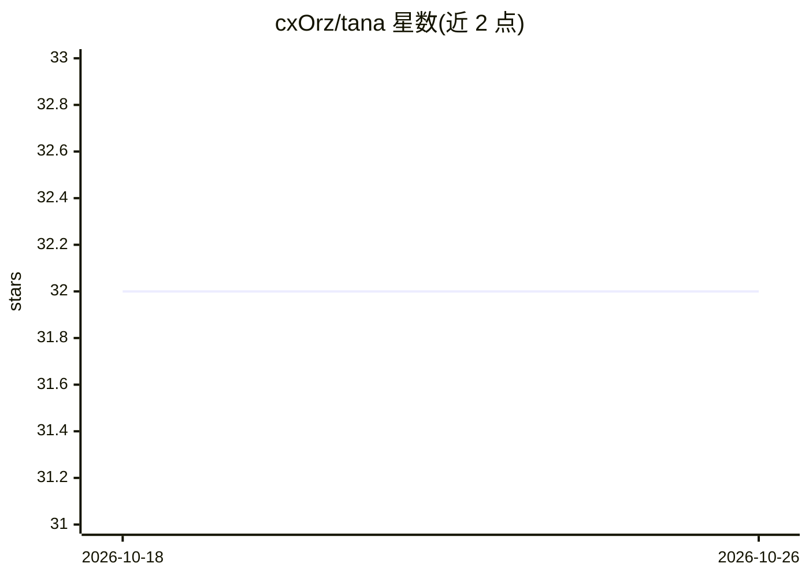

# cxOrz/tana

⭐ 32 · TypeScript · MIT · 推送 2025-12-31 · [GitHub](https://github.com/cxOrz/tana) · 个人维护 · 中文 README

**史莱姆桌宠：陪班陪伴+速记日记与每晚 AI 回顾**

基于 Electron + Vue3 + PixiJS 的桌面宠物应用：显示一只可拖放到副屏的史莱姆，支持自定义皮肤（静态图片或 SpriteSheet 动画）；通过系统通知推送自定义消息（已赚金额提醒、喝水、放松）；ALT+J 唤起速记日记，每晚生成 AI 回顾。AI 能力通过配置文件设置模型、Key 与 Base URL。需 Node v20+，从源码克隆后用 bun 脚本开发运行，可用 Electron Forge 构建当前平台安装包。

## 筛选速览

| 维度 | 判定 | 备注 |
|---|---|---|
| AI 角色 | `ai-enhanced` | 去掉 AI 部分产品仍成立 |
| 许可风险 | `permissive` | MIT |
| 部署形态 | `None` |  |
| 模型依赖 | — | README 未给出锁定关系 |
| 硬件要求 | — | 无带数字的原话,不猜 |
| 安装摩擦 | `low` | 无编译、无系统依赖或容器化 |
| 成熟度 | — | 结构信号不足 |

## 能力要点

- 自定义桌宠皮肤（图片或 SpriteSheet 动画）
- 系统通知推送自定义消息（收入提醒/喝水/放松）
- 快捷键速记日记，每晚生成 AI 回顾
- bun run make 生成当前平台安装包

## 适用场景

- 上班/学习时在副屏养一只桌宠陪伴
- 随手速记想法并每晚查看 AI 生成的回顾
- 自定义皮肤与提醒消息打造个性化桌宠

## 场景标签

`AI 助手` `AI 写作` · 领域:对话与助手

## 证据(README 行号)

> L7: - **桌宠**：一只史莱姆，可拖放到副屏养着，陪你上班。
> L10: - **日记与 AI 回顾**：使用快捷键 ALT + J 唤起速记，随时记录想法、吐槽；每晚生成 AI 回顾，点击通知查看。
> L63: |ai|AI 能力配置（模型、Key、Base URL）|

## 星数曲线

2026-10-18 32 → 2026-10-26 32（+0）

---
*卡片 v1 · prompt 1.4 · 生成 2026-10-26 · 置信度 high · 依据 README sha `9f70cb40ed1d` · [字段定义](../../DATASET.md)*
