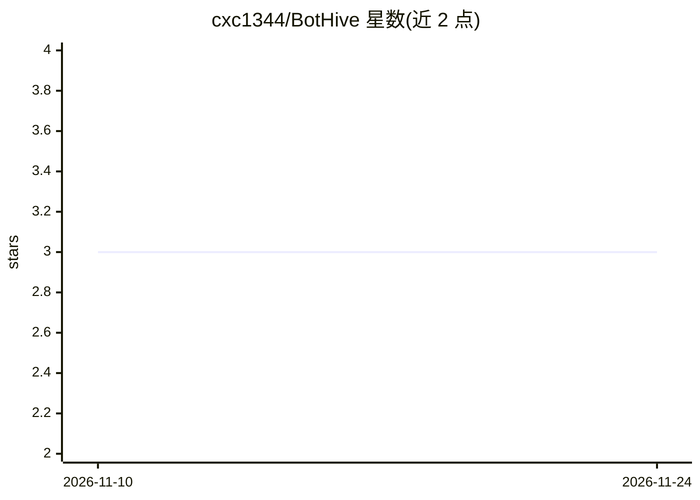

# cxc1344/BotHive

⭐ 3 · Kotlin · MIT · 推送 2026-11-22 · [GitHub](https://github.com/cxc1344/BotHive) · [官网](https://github.com/cxc1344/BotHive/releases/download/v0.6.1/BotHive-v0.6.1.apk) · 个人维护 · 中文 README

**安卓多 Bot 协作应用：用自有 API Key 自建 AI 员工团队**

原生 Kotlin + Jetpack Compose 的安卓应用，单 APK 本地运行，用户自带 API Key 接入任意 OpenAI 兼容服务商。每个 Bot 配独立 Ubuntu 24.04 PRoot 沙箱，可执行 Shell 命令、互相私聊、定时派活；项目模式由总经理 Bot 拆任务、派活、审查打回并汇报。v0.4 起本地设备 Agent 可读写授权文件夹、截屏操作手机界面，支持 Shizuku 特权通道、MCP 远程工具接入与工作流编排。密钥经 Android Keystore 加密，默认仅允许 HTTPS，PRoot 沙箱非强安全边界。

## 筛选速览

| 维度 | 判定 | 备注 |
|---|---|---|
| AI 角色 | `ai-native` | 本体是模型或模型工具 |
| 许可风险 | `permissive` | MIT |
| 部署形态 | `None` |  |
| 模型依赖 | — | README 未给出锁定关系 |
| 硬件要求 | — | 无带数字的原话,不猜 |
| 安装摩擦 | `medium` | 含编译或系统依赖之一 |
| 成熟度 | — | 结构信号不足 |

## 能力要点

- 总经理负责制流水线：立项→计划→并行执行→审查→返工→结项汇报
- 每 Bot 独立 Ubuntu 24.04 PRoot 沙箱，apt 装软件，预装 python3/nodejs/git
- 设备端 Agent：视觉模式截屏看图并以相对坐标点击/长按/拖动操作手机
- OpenAI Function Calling 原生工具调用，MCP 远程工具与工作流步骤链编排

## 适用场景

- 在手机上组建多 Bot 团队，让总经理 Bot 自动拆解并推进项目
- 给每个 Bot 指定不同的服务商、模型与人设进行群聊协作
- 让本地 Agent 代为查看设备状态、读写授权文件夹、操作应用

## 场景标签

`多智能体` `聊天机器人` `GUI 自动化` · 领域:Agent 开发

## 证据(README 行号)

> L22: 安卓版多 Bot 协作应用：用你自己的 API Key 自建 AI「员工」，给每个 Bot 写人设、派模型、建群协作；还能立项让**总经理 Bot** 自己拆任务、派活、审查、打回返工，最后向你汇报。v0.4 起新增 **Agen
> L49: - **总经理负责制流水线**：立项 → 总经理出计划 → 你确认 → 员工并行执行 → 总经理审查 → 不合格打回返工（最多一次）→ 结项汇报
> L66: - **Agent 模式（设备端）**：本地 Agent 可读写用户授权的手机文件夹、查看设备状态与今日应用使用时长、打开应用；可选接入 Shizuku 特权通道获得 shell 级能力；无障碍开启后以**视觉模式**操作屏幕——

## 星数曲线

2026-11-10 3 → 2026-11-24 3（+0）

---
*卡片 v1 · prompt 1.4 · 生成 2026-11-22 · 置信度 high · 依据 README sha `2f5a0a72fd2b` · [字段定义](../../DATASET.md)*
