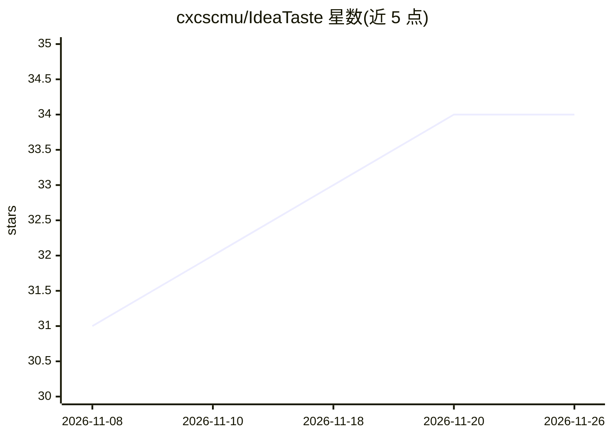

# cxcscmu/IdeaTaste

⭐ 34 · Python · MIT · 推送 2026-11-03 · [GitHub](https://github.com/cxcscmu/IdeaTaste) · [官网](https://cxcscmu.github.io/IdeaTaste) · 组织维护

**评测 LLM agent 科研品味的研究基准：以次年真实论文对照打分**

IdeaTaste 是一个评测研究品味的 benchmark：LLM agent 阅读冻结在 2025 年的文献语料并撰写研究提案，再将提案与同一研究社区 2026 年实际发表的论文对照，按引用与想法两个维度计算四项指标（引用匹配、想法匹配、引用多样性、想法多样性），并由人类专家盲审。数据集（约 530 MB）托管于 Hugging Face。CLI 提供 generate/evaluate 两步：生成阶段一次 300 提案的运行最多约 6,000 次 agent 调用，评测阶段抽取与判分均调用付费 API，产生费用。支持 4 个研究领域、多种前沿模型与本地 vLLM 后端，可自定义模型端点与方法子类扩展。

## 筛选速览

| 维度 | 判定 | 备注 |
|---|---|---|
| AI 角色 | `ai-ecosystem` | LLM/agent 周边工具 |
| 许可风险 | `permissive` | MIT |
| 部署形态 | `library` | 以包/库形式分发 |
| 模型依赖 | local-ok | 支持本地模型 |
| 硬件要求 | — | 无带数字的原话,不猜 |
| 安装摩擦 | `low` | 无编译、无系统依赖或容器化 |
| 成熟度 | — | 结构信号不足 |

## 能力要点

- 提案与 2026 年真实论文对照的引用/想法匹配与多样性四指标
- 支持 6 种模型，含本地 vLLM 服务与 AWS Bedrock 部署选项
- generate 命令支持断点续跑，输出提案/轨迹/LLM 调用三类 JSONL
- 可扩展：OpenAI 兼容端点免改代码接入，方法可子类化注册

## 适用场景

- 评测 LLM agent 生成研究想法与人类研究社区的契合度
- 对比不同模型或提示方法在科研品味任务上的表现
- 开展 AI for Science 方向的学术研究并复现论文设置

## 场景标签

`模型评测` · 领域:评测与运维

## 证据(README 行号)

> L13: IdeaTaste is a benchmark for research taste. LLM agents read a literature corpus frozen at 2025 and write research 
> L44: - **Cost:** both call paid APIs. A 300-proposal population takes up to 6,000 agent calls. Evaluating it takes about

## 星数曲线

2026-11-08 31 → 2026-11-26 34（+3）

---
*卡片 v1 · prompt 1.4 · 生成 2026-11-18 · 置信度 high · 依据 README sha `b834f52a8b7f` · [字段定义](../../DATASET.md)*
