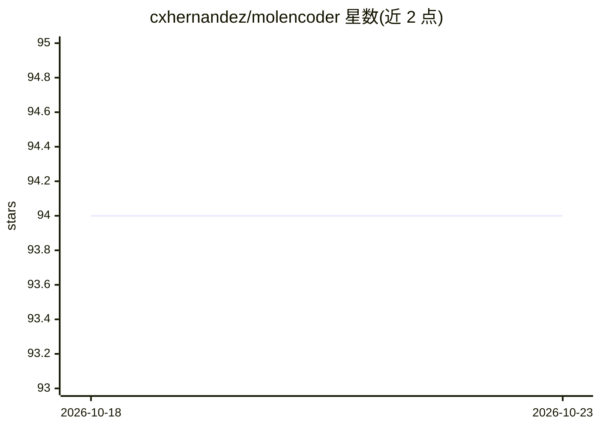

# cxhernandez/molencoder

⭐ 94 · Python · MIT · 推送 2026-01-16 · [GitHub](https://github.com/cxhernandez/molencoder) · 个人维护

**PyTorch 实现的分子自编码器：训练/加载化学分子表征模型**

基于 PyTorch 的分子自动编码器实现，复现 Gómez-Bombarelli 等人的工作。提供 CLI 命令下载 ChEMBL22 化学分子数据集、训练自编码器模型（支持 --cuda 与断点续训），并在 ref/ 目录附带预训练参考模型（验证集约 98% 准确率）。编码/解码命令尚未实现（见 TODO）。面向计算化学与深度学习研究者的科研工具，从源码通过 setup.py 安装。

## 筛选速览

| 维度 | 判定 | 备注 |
|---|---|---|
| AI 角色 | `ai-native` | 本体是模型或模型工具 |
| 许可风险 | `permissive` | MIT |
| 部署形态 | `None` |  |
| 模型依赖 | — | README 未给出锁定关系 |
| 硬件要求 | — | 无带数字的原话,不猜 |
| 安装摩擦 | `medium` | 含编译或系统依赖之一 |
| 成熟度 | — | 结构信号不足 |

## 能力要点

- CLI 下载 ChEMBL22 数据集并训练模型
- 支持 CUDA 加速与从 checkpoint 续训
- 附带预训练参考模型（验证集约 98% 准确率）
- encode/decode 命令尚未实现

## 适用场景

- 训练化学分子的自动编码器模型
- 使用预训练模型做分子表征的科研实验
- 复现 Gómez-Bombarelli 分子自动编码器论文工作

## 场景标签

`科研工具` · 领域:学习与行业

## 证据(README 行号)

> L2: Molecular AutoEncoder in PyTorch
> L20: $ molencoder train --dataset data/chembl22.h5

## 星数曲线

2026-10-18 94 → 2026-10-23 94（+0）

---
*卡片 v1 · prompt 1.4 · 生成 2026-10-23 · 置信度 high · 依据 README sha `58c920f84090` · [字段定义](../../DATASET.md)*
