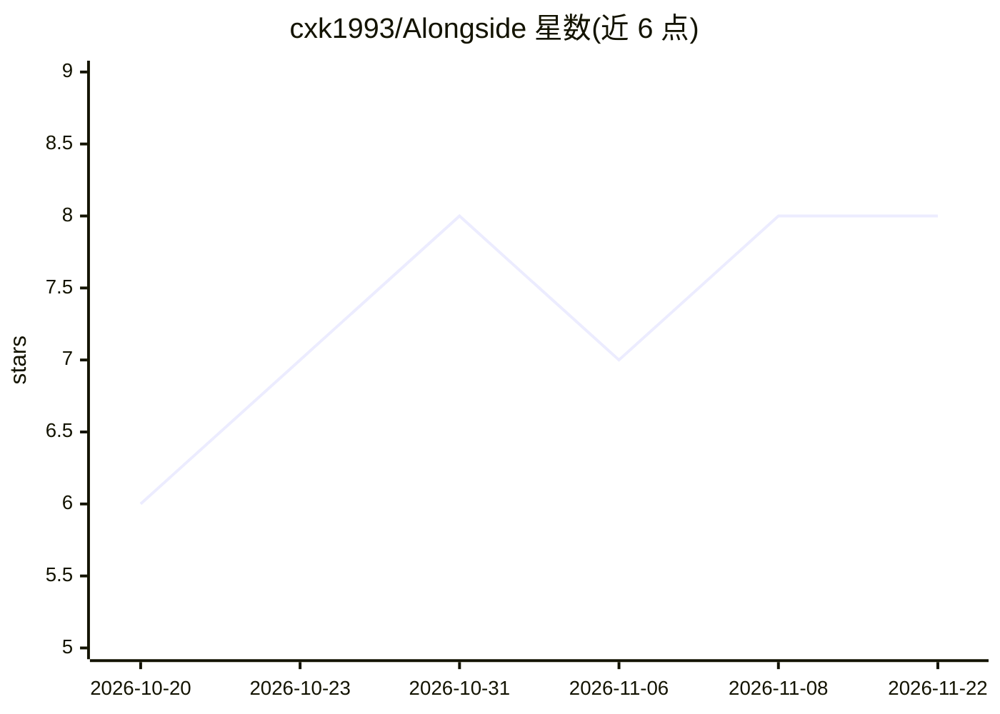

# cxk1993/Alongside

⭐ 8 · Python · Apache-2.0 · 推送 2026-11-18 · [GitHub](https://github.com/cxk1993/Alongside) · 组织维护 · 中文 README

**自托管的插件化个人 AI 生活协助系统平台**

基于 FastAPI 后端与 Web 前端的个人系统：内核只提供窗口/路由等框架，功能全部由插件承载，插件在 manifest.json 中声明窗口、路由、权限与能力，并映射为 MCP 工具供外部 AI Agent 调用。通过能力声明、权限分级与回滚审计治理 Agent 行为；数据存储于本地 data/ 目录（SQLite + WAL）。面向想要自托管、不绑定单一厂商的普通用户与插件开发者；项目处于 PoC 后的工程化重构阶段，官方整合包尚未交付。

## 筛选速览

| 维度 | 判定 | 备注 |
|---|---|---|
| AI 角色 | `ai-ecosystem` | LLM/agent 周边工具 |
| 许可风险 | `permissive` | Apache-2.0 |
| 部署形态 | `self-host` | docker 或自建部署 |
| 模型依赖 | — | README 未给出锁定关系 |
| 硬件要求 | — | 无带数字的原话,不猜 |
| 安装摩擦 | `low` | 无编译、无系统依赖或容器化 |
| 成熟度 | `idea` | |

## 能力要点

- 插件架构：manifest.json 声明能力，内核机械发现，无业务硬编码
- 插件能力映射为 MCP 工具，外部 Agent 经 MCP 调用本地能力
- 数据集中于 data/ 目录（SQLite+WAL），复制目录即迁移备份
- 本地跨平台脚本 tools/task.py 提供统一入口（无 make 也可用）

## 适用场景

- 自托管一套属于自己的生活事务整理系统（日程/待办/账单/笔记）
- 让外部 AI Agent 通过 MCP 调用自己系统里的插件能力
- 为第三方软件编写适配插件接入个人系统
- 打包面向特定人群的插件整合包

## 场景标签

`AI 助手` · 领域:对话与助手

## 证据(README 行号)

> L13: > **内核只提供框架，能力全部由插件长出来** —— 详见 `docs/adr/0002-插件协议.md`。
> L73: - **MCP 是 AI 的正门**：插件声明的能力会映射成 MCP 工具，外部 Agent 可以像调用本地能力一样调用它们。
> L32: 1. **架构灵活，一切皆插件**：这套系统架构灵活（无特权内核+一切皆插件），功能可以借助插件无限扩展，可以从外部接入市面上任何 AI Agent，可以借助插件整合包一键装配启动，并且可以随时调整、自由搭配。

## 星数曲线

2026-10-20 6 → 2026-11-22 8（+2）

---
*卡片 v1 · prompt 1.4 · 生成 2026-11-20 · 置信度 mid · 依据 README sha `8198dc80003a` · [字段定义](../../DATASET.md)*
