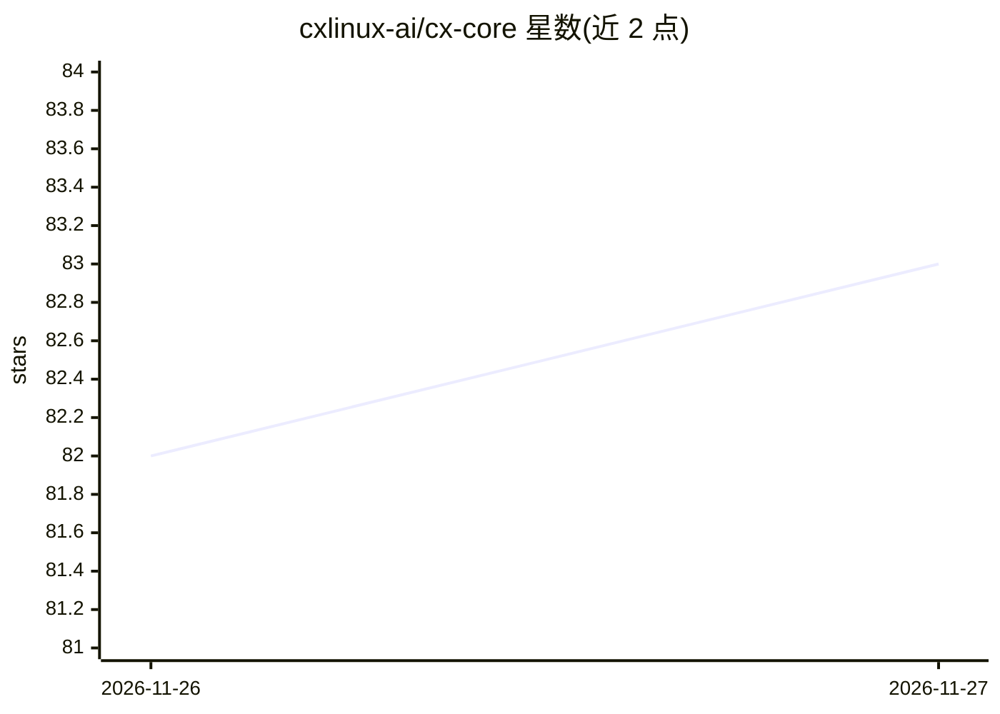

# cxlinux-ai/cx-core

⭐ 83 · Rust · NOASSERTION · 推送 2026-11-23 · [GitHub](https://github.com/cxlinux-ai/cx-core) · [官网](https://cxlinux.ai/) · 组织维护

**AI 原生 Linux 终端：自然语言执行 Ubuntu/Debian 系统管理**

CX Linux 定位为 AI 原生操作系统层，核心组件为 cx-terminal 终端，提供 cx ask/install/what/fix/explain 等命令，将自然语言请求转换为经确认后执行的命令。AI 引擎为 Rust 编写的 LLM 编排，默认使用约 5 GB 的本地模型离线回答，未配置 --local 时可回退到 Claude API 或 Ollama。安全机制包括命令预览、[y/N] 确认与空输入视为拒绝。Ubuntu 24.04+ amd64 经验证，其他平台源码构建未验证。

## 筛选速览

| 维度 | 判定 | 备注 |
|---|---|---|
| AI 角色 | `ai-native` | 本体是模型或模型工具 |
| 许可风险 | `none` | NOASSERTION |
| 部署形态 | `None` |  |
| 模型依赖 | local-ok | 支持本地模型 |
| 硬件要求 | — | 无带数字的原话,不猜 |
| 安装摩擦 | `high` | 编译与系统依赖俱全 |
| 成熟度 | — | 结构信号不足 |

## 能力要点

- cx ask 自然语言转命令，预览确认后才执行
- 本地约 5 GB 模型离线回答，可回退 Claude API 或 Ollama
- AI Side-Panel（Ctrl+Space）携带完整终端上下文
- 基于 WezTerm 的 GPU 加速终端与 Rust LLM 编排

## 适用场景

- 用自然语言完成 Ubuntu/Debian 系统管理任务
- 让 AI 解释和修复终端报错
- 离线环境下使用本地模型查询系统问题

## 场景标签

`AI 助手` · 领域:对话与助手

## 证据(README 行号)

> L44: CX Linux is an AI-native operating system that simplifies system administration through natural language. It provid
> L72: |`cx ask`|Ask in natural language; shows the suggested commands (add `-d` to run AI suggestions after a `[y/N]` con
> L91: |**APT package**|Ubuntu 24.04 LTS or newer, amd64 (the package needs glibc 2.39) — verified|

## 星数曲线

2026-11-26 82 → 2026-11-27 83（+1）

---
*卡片 v1 · prompt 1.4 · 生成 2026-11-26 · 置信度 high · 依据 README sha `0f17cba57b45` · [字段定义](../../DATASET.md)*
