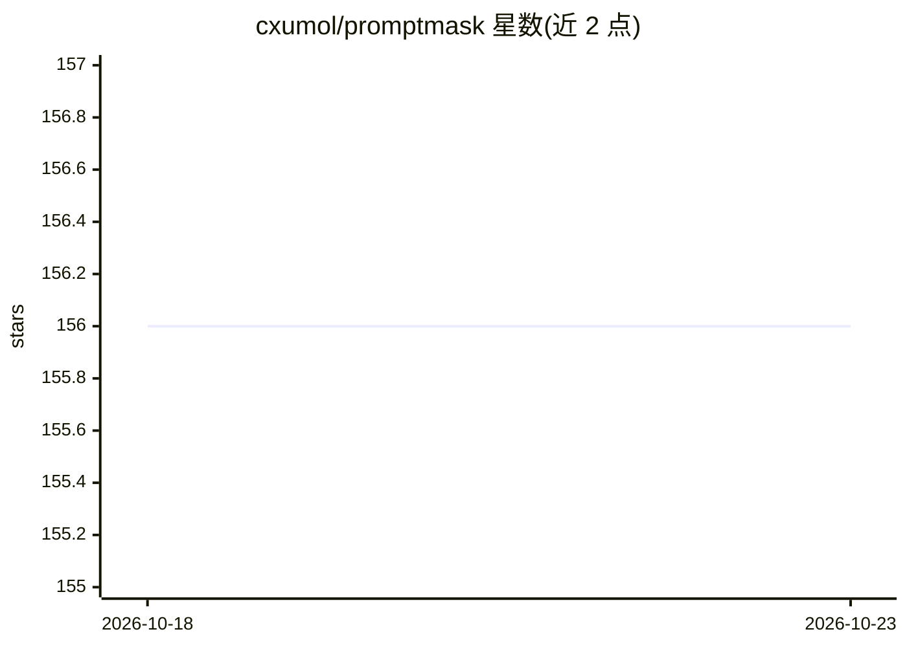

# cxumol/promptmask

⭐ 156 · Python · MIT · 推送 2026-01-04 · [GitHub](https://github.com/cxumol/promptmask) · [官网](https://promptmask.rtfd.org/) · 个人维护

**本地 LLM 隐私过滤层：发送前脱敏敏感数据，返回后还原**

PromptMask 在用户与第三方 AI 服务之间加入脱敏层：调用本地（或可信）OpenAI 兼容 LLM 识别敏感数据，发出前将其替换为占位符，收到响应后再还原。提供四种接入方式：Python 库（PromptMask 类细粒度控制）、openai.OpenAI 的 drop-in 替代（OpenAIMasked）、本地 API 网关（promptmask-web）与 Web UI。默认连接 localhost:11434（如 Ollama），也可配置远程可信端点。限制：需自行准备一个 OpenAI 兼容的 LLM 端点；附带基准脚本用于挑选合适的脱敏模型。

## 筛选速览

| 维度 | 判定 | 备注 |
|---|---|---|
| AI 角色 | `ai-ecosystem` | LLM/agent 周边工具 |
| 许可风险 | `permissive` | MIT |
| 部署形态 | `library` | 以包/库形式分发 |
| 模型依赖 | local-ok | 支持本地模型 |
| 硬件要求 | — | 无带数字的原话,不猜 |
| 安装摩擦 | `low` | 无编译、无系统依赖或容器化 |
| 成熟度 | — | 结构信号不足 |

## 能力要点

- 本地脱敏/还原敏感数据后再与云端 AI 交互
- OpenAIMasked 可 drop-in 替换 openai.OpenAI SDK（含流式请求）
- promptmask-web 提供本地网关、Web UI 与 Swagger 文档
- TOML 配置文件与环境变量的多级配置优先级

## 适用场景

- 继续使用云端 AI 服务但不想泄露个人敏感信息
- 无代码改造地将现有 OpenAI 兼容工具指向本地网关
- 在 Python 程序中对发送给 LLM 的数据做细粒度脱敏控制

## 场景标签

`网络安全` `模型网关` · 领域:Agent 开发

## 证据(README 行号)

> L26: The core principle is to use a trusted (local) model as a "privacy filter" for a powerful, remote model. The proces
> L38: ||**Existing OpenAI-compatible Tools**|**Direct Use / Custom Integration**|

## 星数曲线

2026-10-18 156 → 2026-10-23 156（+0）

---
*卡片 v1 · prompt 1.4 · 生成 2026-10-22 · 置信度 high · 依据 README sha `f66eb925880f` · [字段定义](../../DATASET.md)*
