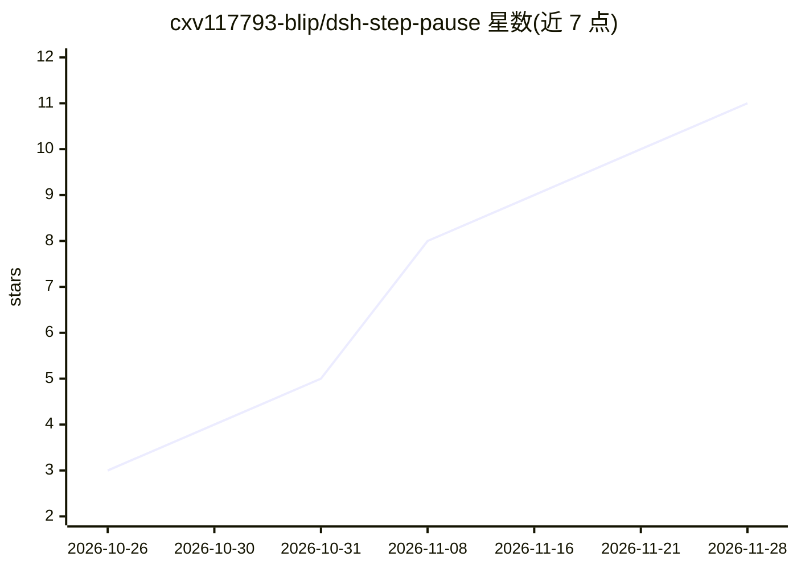

# cxv117793-blip/dsh-step-pause

⭐ 11 · JavaScript · MIT · 推送 2026-11-02 · [GitHub](https://github.com/cxv117793-blip/dsh-step-pause) · [官网](https://github.com/cxv117793-blip/dsh-step-pause/releases/latest) · 个人维护 · 中文 README

**给 DSH 用户的长任务分步进度汇报插件**

DeepSeek Harness（DSH）插件：挂在 agent/pre-step 步骤边界上，每满可配置的 N 步向当前步骤输入批次追加一条消息，让模型先输出正在做什么/已完成什么/接下来做什么/卡点四项小结再继续，不产生额外回合、不等待用户确认。默认仅主智能体注入，提供设置页八项配置（间隔、每轮上限、自动续跑等），保存即生效。README 附带基于本机会话日志的成本实测与复现脚本。限制：不支持打断正在运行的工具调用，客户端半边加载失败会白屏。

## 筛选速览

| 维度 | 判定 | 备注 |
|---|---|---|
| AI 角色 | `ai-ecosystem` | LLM/agent 周边工具 |
| 许可风险 | `permissive` | MIT |
| 部署形态 | `library` | 以包/库形式分发 |
| 模型依赖 | locked-api |  |
| 硬件要求 | — | 无带数字的原话,不猜 |
| 安装摩擦 | `low` | 无编译、无系统依赖或容器化 |
| 成熟度 | — | 结构信号不足 |

## 能力要点

- 每 N 步注入一次性检查点，汇报与后续动作在同一次响应内完成
- 默认只在主智能体汇报，可按 agent.id 过滤子智能体
- 配套 node 脚本从会话日志复现开销与覆盖率统计
- 配置写回 cordis.patch.yml，保存即生效无需重启

## 适用场景

- 长任务跑到几十上百步时了解当前进度与卡点
- 控制长会话中进度汇报的频率与开销
- 避免并行子任务重复注入进度信息

## 场景标签

 · 领域:开发者工具/agent 基础设施

## 证据(README 行号)

> L14: 长任务跑到第 30、40 步，你往往不知道它在干什么、卡在哪、还要多久。这个插件按固定节奏
> L352: - DSH `0.2.0-rc.2` 与 `0.2.1-rc.2` 上实测可用（`dsh.compatibility.dshReleases` 声明）；

## 星数曲线

2026-10-26 3 → 2026-11-28 11（+8）

---
*卡片 v1 · prompt 1.4 · 生成 2026-11-20 · 置信度 mid · 依据 README sha `2a9e131b36f6` · [字段定义](../../DATASET.md)*
