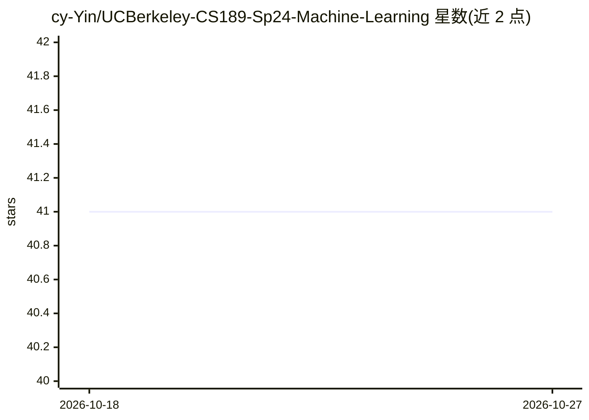

# cy-Yin/UCBerkeley-CS189-Sp24-Machine-Learning

⭐ 41 · Jupyter Notebook · MIT · 推送 2026-02-04 · [GitHub](https://github.com/cy-Yin/UCBerkeley-CS189-Sp24-Machine-Learning) · [官网](https://people.eecs.berkeley.edu/~jrs/189s24/) · 个人维护

**UC Berkeley CS189/289A 2024 春季机器学习课程资料与作业解答合集**

个人整理的课程仓库，收录 UC Berkeley CS189/289A 2024 春季《机器学习导论》的讨论、考试资料以及作者本人全部 6 次作业的解答（hw2 无编程部分）。因数据集过大不上传至仓库，数据集（.npy/.npz）可从课程网站获取，空白作业 .zip 含完整大数据集发布在 Releases 中。主题标签覆盖线性回归、逻辑回归、决策树、CNN、神经网络与深度学习。

## 筛选速览

| 维度 | 判定 | 备注 |
|---|---|---|
| AI 角色 | `ai-knowledge` | 知识聚合/清单类 |
| 许可风险 | `permissive` | MIT |
| 部署形态 | `None` |  |
| 模型依赖 | — | README 未给出锁定关系 |
| 硬件要求 | — | 无带数字的原话,不猜 |
| 安装摩擦 | `low` | 无编译、无系统依赖或容器化 |
| 成熟度 | — | 结构信号不足 |

## 能力要点

- 包含全部 6 次作业的个人解答
- 收录课程讨论与考试资料
- 空白作业 zip（含大数据集）发布于 Releases

## 适用场景

- 学习伯克利机器学习课程内容并对照作业解答
- 查找课程讨论与考试资料
- 从 Releases 获取含数据集的原始作业包

## 场景标签

`教程课程` · 领域:学习与行业

## 证据(README 行号)

> L3: This repository contains all the materials of the course "Introduction to Machine Learning" in the UC Berkeley CS189

## 星数曲线

2026-10-18 41 → 2026-10-27 41（+0）

---
*卡片 v1 · prompt 1.4 · 生成 2026-10-25 · 置信度 high · 依据 README sha `58cac5e46933` · [字段定义](../../DATASET.md)*
