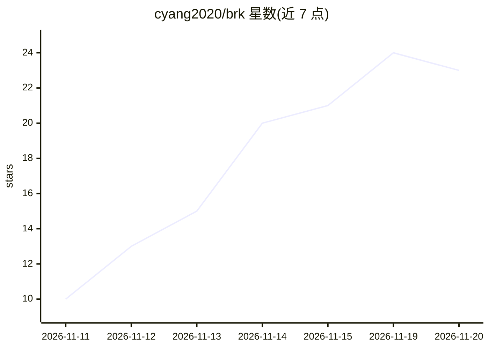

# cyang2020/brk

⭐ 23 · Swift · MIT · 推送 2026-11-19 · [GitHub](https://github.com/cyang2020/brk) · [官网](https://cyang2020.github.io/brk/) · 个人维护

**用 Swift 重建的 macOS 原生 Arc 浏览器，带本地 AI 功能**

以 Swift 6 + AppKit + CEF（Chromium 156）在 macOS 上重建 Arc 浏览器，按 Arc 1.170 逐项复刻其功能（sidebar、Spaces、Boosts 等），并新增升级版 ⌘T 命令栏、可读取并操作标签页的 AI 面板、基于 EmbeddingGemma 的本地语义搜索（约 20 ms）。AI 部分复用本机已登录的编码 agent（Claude、Codex、Gemini、Cursor、OpenCode）或自配 Anthropic/OpenAI API key；小任务（命名标签、找重复页）由本地小模型离线完成。支持从 Arc/Chrome/Safari 等浏览器直接导入数据；需 macOS 14 以上，提供 Apple silicon 与 Intel 的 dmg 安装包，无需账号，MIT 许可。

## 筛选速览

| 维度 | 判定 | 备注 |
|---|---|---|
| AI 角色 | `ai-enhanced` | 去掉 AI 部分产品仍成立 |
| 许可风险 | `permissive` | MIT |
| 部署形态 | `desktop` | 安装包/桌面程序 |
| 模型依赖 | — | README 未给出锁定关系 |
| 硬件要求 | — | 无带数字的原话,不猜 |
| 安装摩擦 | `low` | 无编译、无系统依赖或容器化 |
| 成熟度 | — | 结构信号不足 |

## 能力要点

- 命令栏集成计算/翻译/文件搜索/agent 调用等多种模式
- AI agent 可读取、对比并操作标签页，且工具调用需用户批准
- 本地 EmbeddingGemma 语义搜索标签页/历史/文件，索引不离开本机
- 从 Arc、Chrome、Safari 等浏览器直接读取并导入书签、历史与密码

## 适用场景

- Arc 停更后继续使用熟悉的浏览器工作流
- 在浏览器里直接调用已订阅的编码 agent 处理当前页面
- 用自然语言按内容而非标题查找标签页和文件
- 首次迁移时从旧浏览器带入书签、密码与历史

## 场景标签

`语义搜索` `AI 助手` · 领域:对话与助手

## 证据(README 行号)

> L36: Everything you know from Arc is here: the sidebar, Spaces, Favorites, Pinned tabs, split view, Little Arc, Peek, Bo
> L86:  Settings: Claude Code as the AI, and the models on this Mac
> L100: **An agent that can see your tabs.** Open the AI panel with ⌥⌘A, or drag a tab to the right edge of the window. Dr

## 星数曲线

2026-11-11 10 → 2026-11-20 23（+13）

---
*卡片 v1 · prompt 1.4 · 生成 2026-11-18 · 置信度 high · 依据 README sha `26e2bd0ffeed` · [字段定义](../../DATASET.md)*
