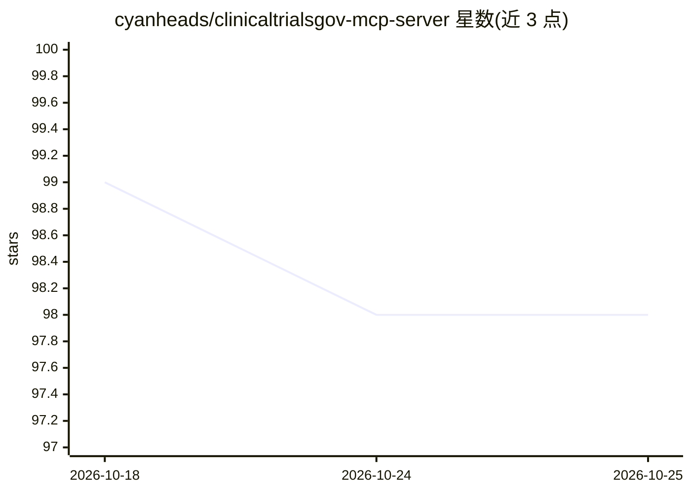

# cyanheads/clinicaltrialsgov-mcp-server

⭐ 98 · TypeScript · Apache-2.0 · 推送 2026-10-23 · [GitHub](https://github.com/cyanheads/clinicaltrialsgov-mcp-server) · [官网](https://www.npmjs.com/package/clinicaltrialsgov-mcp-server) · 个人维护

**MCP 服务器：检索 ClinicalTrials.gov 试验并匹配患者候选试验**

基于 TypeScript/Bun 的 MCP 服务器，提供 7 个工具、1 个资源与 1 个提示词，封装 ClinicalTrials.gov REST API v2：全文与字段检索 60 万+ 研究记录、按 NCT ID 获取完整试验方案与结果、字段与合法值发现、以及按年龄/性别/地点/病情匹配招募中试验（不检查纳入/排除标准）。无需 API key，内置 ~1 req/sec 限流队列与重试退避。支持 STDIO 与 Streamable HTTP 传输，可用 npx/Docker/源码部署，也提供公共托管实例。给使用 MCP 客户端的临床研究人员与开发者使用。

## 筛选速览

| 维度 | 判定 | 备注 |
|---|---|---|
| AI 角色 | `ai-ecosystem` | LLM/agent 周边工具 |
| 许可风险 | `permissive` | Apache-2.0 |
| 部署形态 | `self-host` | docker 或自建部署 |
| 模型依赖 | — | README 未给出锁定关系 |
| 硬件要求 | — | 无带数字的原话,不猜 |
| 安装摩擦 | `low` | 无编译、无系统依赖或容器化 |
| 成熟度 | — | 结构信号不足 |

## 能力要点

- 7 个工具覆盖检索、详情、计数、字段发现、结果获取与患者-试验匹配
- 患者匹配工具按人口学与地理位置筛选招募中试验并输出漏斗统计
- 内置限流队列、指数退避重试与字段名自动纠正
- 支持 STDIO/Streamable HTTP、可插拔认证与 OpenTelemetry 追踪

## 适用场景

- 让 AI agent 检索临床试验注册与结果数据
- 按患者资料匹配候选招募中的临床试验
- 对某疾病领域做临床试验格局分析

## 场景标签

`科研工具` · 领域:学习与行业

## 证据(README 行号)

> L2:  Search ClinicalTrials.gov trials, retrieve study details and results, and match patients to candidate trials via MC
> L15: Search 600K+ studies on ClinicalTrials.gov, the US National Library of Medicine's trial registry. Fetch full study 
> L93: Built on `@cyanheads/mcp-ts-core`: stdio and Streamable HTTP transports, pluggable auth (`none` / `jwt` / `oauth`),

## 星数曲线

2026-10-18 99 → 2026-10-25 98（-1）

---
*卡片 v1 · prompt 1.4 · 生成 2026-10-23 · 置信度 high · 依据 README sha `066211b1ad2e` · [字段定义](../../DATASET.md)*
