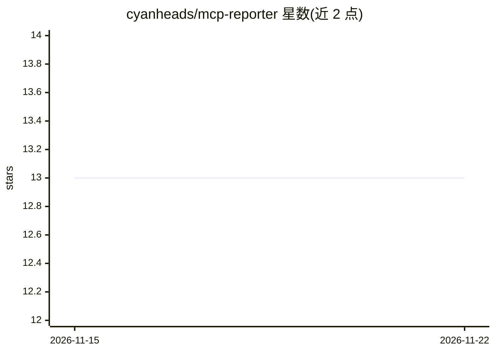

# cyanheads/mcp-reporter

⭐ 13 · TypeScript · Apache-2.0 · 推送 2026-11-15 · [GitHub](https://github.com/cyanheads/mcp-reporter) · 个人维护

**为 MCP 服务器生成 Markdown 能力报告的 CLI/库**

连接本地 stdio 进程与远程 Streamable HTTP 端点的 MCP 服务器，读取其声明的 tools、resources、resource templates、prompts 与服务器元数据，生成可随项目文档保存或交给其他工具的 Markdown 报告。仅枚举声明内容，不执行工具、不读取资源内容、不展开 prompts。支持 legacy/auto/2026-07-28 三种协议模式、分页收集与失败隔离，凭据类配置值在诊断输出中被省略。提供 CLI 与 ESM 库两种使用方式。

## 筛选速览

| 维度 | 判定 | 备注 |
|---|---|---|
| AI 角色 | `ai-ecosystem` | LLM/agent 周边工具 |
| 许可风险 | `permissive` | Apache-2.0 |
| 部署形态 | `library` | 以包/库形式分发 |
| 模型依赖 | — | README 未给出锁定关系 |
| 硬件要求 | — | 无带数字的原话,不猜 |
| 安装摩擦 | `low` | 无编译、无系统依赖或容器化 |
| 成熟度 | — | 结构信号不足 |

## 能力要点

- 枚举 MCP 服务器的 tools/resources/templates/prompts 及 schema、注解、图标等元数据
- 支持 legacy、auto、2026-07-28 三种协议协商模式
- 连接失败不丢弃相邻成功结果，各能力标记 not advertised/complete/incomplete
- CLI（npx 运行）与 ESM 库（bun add）双形态

## 适用场景

- 为团队 MCP 服务器生成随项目维护的能力目录文档
- 把服务器声明的工具清单交给其他工具消费
- 排查 MCP 服务器连接失败与声明不完整问题

## 场景标签

 · 领域:LLM 生态/MCP 工具

## 证据(README 行号)

> L9: `mcp-reporter` connects to local stdio processes and remote Streamable HTTP endpoints, reads their advertised capabi
> L11: It enumerates tools, resources, resource templates, and prompts. It does not execute tools, read resource contents,

## 星数曲线

2026-11-15 13 → 2026-11-22 13（+0）

---
*卡片 v1 · prompt 1.4 · 生成 2026-11-18 · 置信度 high · 依据 README sha `7fe7068da05e` · [字段定义](../../DATASET.md)*
