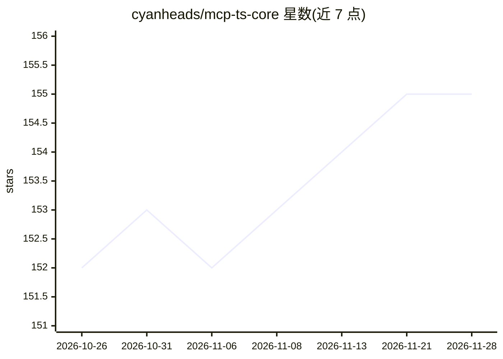

# cyanheads/mcp-ts-core

⭐ 155 · TypeScript · Apache-2.0 · 推送 2026-11-27 · [GitHub](https://github.com/cyanheads/mcp-ts-core) · [官网](https://www.npmjs.com/package/@cyanheads/mcp-ts-core) · 个人维护

**给开发者用 TypeScript 构建 MCP 服务器的基础框架**

面向 TypeScript 开发者的 MCP 服务器构建框架：提供 typed builder 定义 tools/resources/prompts/MCP Apps，运行时覆盖鉴权（JWT/OAuth 与 scope）、多后端租户存储、结构化日志、可选 OpenTelemetry，以及 stdio/HTTP/Cloudflare Workers 三种运行方式。附带 enrichment 与 errors 声明契约、定义 lint、契约测试与模糊测试，并随脚手架提供供 Agent 执行的构建/测试/安全审查/发布工作流（Agent Skills），支持 Bun、Node.js 24+。

## 筛选速览

| 维度 | 判定 | 备注 |
|---|---|---|
| AI 角色 | `ai-ecosystem` | LLM/agent 周边工具 |
| 许可风险 | `permissive` | Apache-2.0 |
| 部署形态 | `library` | 以包/库形式分发 |
| 模型依赖 | — | README 未给出锁定关系 |
| 硬件要求 | — | 无带数字的原话,不猜 |
| 安装摩擦 | `low` | 无编译、无系统依赖或容器化 |
| 成熟度 | — | 结构信号不足 |

## 能力要点

- typed builders 定义 tools/resources/prompts/MCP Apps，统一经 createApp() 注册
- JWT/OAuth scope 鉴权与 in-memory/filesystem/Supabase/Cloudflare D1/KV/R2 存储后端
- enrichment/errors 声明契约 + definition linting、契约测试、fuzz testing
- stdio/HTTP/Cloudflare Workers 多运行时，支持 2025 与 2026-07-28 客户端兼容层

## 适用场景

- 把团队 API 或数据集通过 MCP 接入 AI 客户端
- 在 Cloudflare Workers 上托管 MCP 服务
- 让编码 Agent 按内置 Skills 完成 MCP 服务器的开发与发布

## 场景标签

`Agent 框架` · 领域:Agent 开发

## 证据(README 行号)

> L2:  Agent-native TypeScript framework for building MCP servers.
> L13: Connect an API, a dataset, or a workflow to an AI agent through the Model Context Protocol (MCP). Your project hold

## 星数曲线

2026-10-26 152 → 2026-11-28 155（+3）

---
*卡片 v1 · prompt 1.4 · 生成 2026-11-28 · 置信度 mid · 依据 README sha `2ff2987d289f` · [字段定义](../../DATASET.md)*
