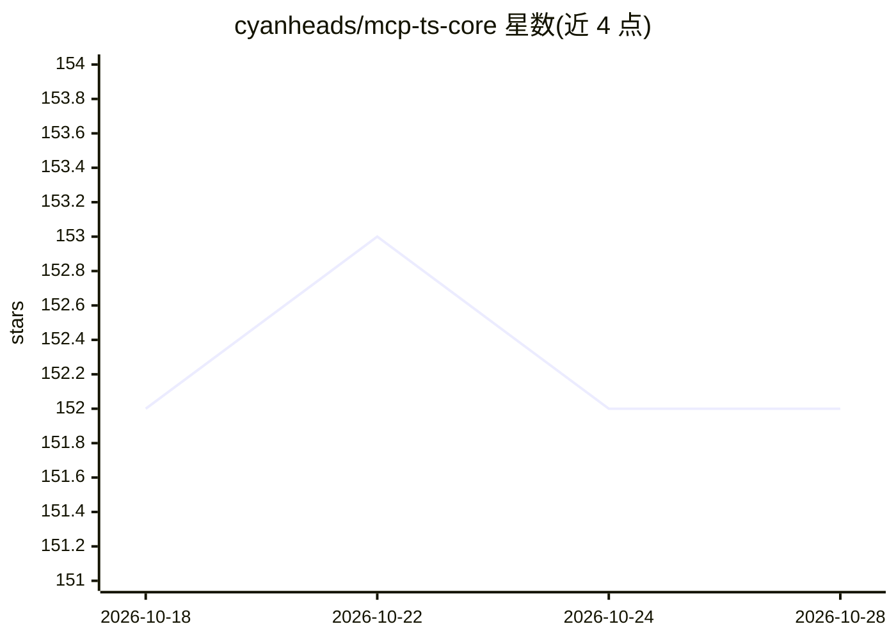

# cyanheads/mcp-ts-core

⭐ 152 · TypeScript · Apache-2.0 · 推送 2026-10-26 · [GitHub](https://github.com/cyanheads/mcp-ts-core) · [官网](https://www.npmjs.com/package/@cyanheads/mcp-ts-core) · 个人维护

**给开发者的 TypeScript MCP 服务器构建框架**

面向 TypeScript 开发者的 Agent-native 框架，用于构建 MCP（Model Context Protocol）服务器：提供 tool/resource/prompt 的类型化构建器、JWT/OAuth 鉴权、租户级存储（内存/文件/Supabase/Cloudflare D1/KV/R2）、stdio 与 HTTP 传输、结构化日志与可选 OpenTelemetry。脚手架附带供编码 Agent 使用的 Agent Skills（工具设计、测试、安全审查、发版）。可运行于 Bun、Node.js 24+ 或 Cloudflare Workers，可选集成 DuckDB DataCanvas 与 SQLite Mirror 模块。

## 筛选速览

| 维度 | 判定 | 备注 |
|---|---|---|
| AI 角色 | `ai-ecosystem` | LLM/agent 周边工具 |
| 许可风险 | `permissive` | Apache-2.0 |
| 部署形态 | `library` | 以包/库形式分发 |
| 模型依赖 | — | README 未给出锁定关系 |
| 硬件要求 | — | 无带数字的原话,不猜 |
| 安装摩擦 | `low` | 无编译、无系统依赖或容器化 |
| 成熟度 | — | 结构信号不足 |

## 能力要点

- tool/resource/prompt/appTool 类型化构建器，通过 createApp() 注册
- JWT/OAuth 鉴权与租户级可切换后端存储
- stdio 与 HTTP 传输，支持 Bun/Node.js 与 Cloudflare Workers 入口
- enrichment/errors 声明式契约、定义 lint、契约测试与模糊测试

## 适用场景

- 把团队 API 或数据集封装成 MCP 服务器供 AI Agent 调用
- 让 Claude Code/Codex 等编码 Agent 按附带的 Skills 生成服务器代码
- 在 Cloudflare Workers 上托管带鉴权的 MCP 服务

## 场景标签

`Agent 框架` · 领域:Agent 开发

## 证据(README 行号)

> L2:  Agent-native TypeScript framework for building MCP servers.
> L13: Connect an API, a dataset, or a workflow to an AI agent through the Model Context Protocol (MCP). Your project hold

## 星数曲线

2026-10-18 152 → 2026-10-28 152（+0）

---
*卡片 v1 · prompt 1.4 · 生成 2026-10-22 · 置信度 high · 依据 README sha `995bee7a9a48` · [字段定义](../../DATASET.md)*
