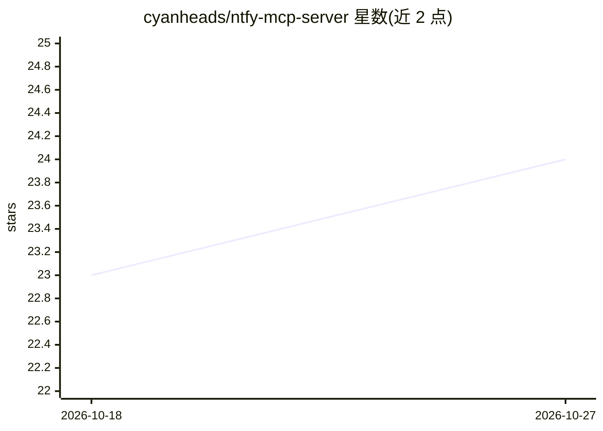

# cyanheads/ntfy-mcp-server

⭐ 24 · TypeScript · Apache-2.0 · 推送 2026-10-17 · [GitHub](https://github.com/cyanheads/ntfy-mcp-server) · [官网](https://www.npmjs.com/package/ntfy-mcp-server) · 个人维护

**让 AI agent 通过 MCP 收发管理 ntfy 推送通知的服务器**

基于 TypeScript/Bun 的 MCP 服务器，向 AI agent 暴露 4 个工具与 1 个资源：发布/更新 ntfy 通知、清除/删除已发通知（需用户确认）、按时间窗和过滤器拉取主题消息快照、查询 emoji 标签短码。支持 stdio 与 Streamable HTTP 两种传输，可插拔认证（none/jwt/oauth）与存储（内存/文件/Supabase/Cloudflare），含 SSRF 防护、重试与分页机制。面向在 Claude Desktop、Cursor、VS Code 等 MCP 客户端中使用通知能力的开发者和 agent 场景，公共 ntfy.sh 无需账号即可用。

## 筛选速览

| 维度 | 判定 | 备注 |
|---|---|---|
| AI 角色 | `ai-ecosystem` | LLM/agent 周边工具 |
| 许可风险 | `permissive` | Apache-2.0 |
| 部署形态 | `self-host` | docker 或自建部署 |
| 模型依赖 | — | README 未给出锁定关系 |
| 硬件要求 | — | 无带数字的原话,不猜 |
| 安装摩擦 | `low` | 无编译、无系统依赖或容器化 |
| 成熟度 | — | 结构信号不足 |

## 能力要点

- 4 个工具：发布/更新、清除/删除（带用户确认）、消息拉取、emoji 标签查询
- 支持 stdio 与 Streamable HTTP 传输，认证与存储可插拔
- 类型化错误码、分页游标与截断提示，便于 agent 分支处理
- base_url 覆盖可选 SSRF 防护（NTFY_BLOCK_PRIVATE_HOSTS）

## 适用场景

- 让 AI agent 在任务完成或异常时向手机推送通知
- agent 拉取 ntfy 主题近期消息做状态检查
- 在自托管 ntfy 服务器的受保护主题上发送带认证的通知

## 场景标签

 · 领域:AI 工具集成/通知

## 证据(README 行号)

> L2:  Send, manage, and replay ntfy push notifications via MCP. STDIO or Streamable HTTP.
> L19: |`ntfy_publish_message`|Send or update a push notification on an ntfy topic.|
> L68: Built on `@cyanheads/mcp-ts-core`: stdio and Streamable HTTP transports, pluggable auth (`none` / `jwt` / `oauth`),

## 星数曲线

2026-10-18 23 → 2026-10-27 24（+1）

---
*卡片 v1 · prompt 1.4 · 生成 2026-10-27 · 置信度 high · 依据 README sha `175848918df0` · [字段定义](../../DATASET.md)*
