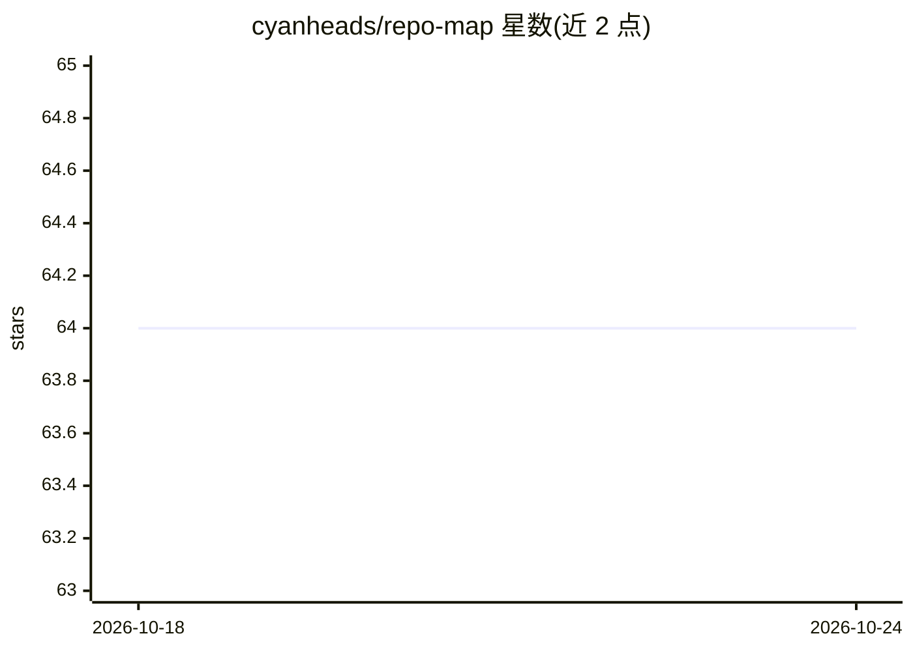

# cyanheads/repo-map

⭐ 64 · Python · Apache-2.0 · 推送 2026-10-20 · [GitHub](https://github.com/cyanheads/repo-map) · [官网](https://pypi.org/project/repo-map/) · 个人维护

**CLI 工具：遍历仓库并生成带 LLM 注释的文件树 Markdown 报告**

Python 命令行工具：扫描仓库目录，把符合条件的文本文件（≤64KiB、UTF-8）通过 OpenRouter 发送给 LLM 分析，为每个文件生成描述、易错点、维护标记、架构角色、关键依赖与重构/安全建议，汇总写入 Markdown 树形报告。分析结果缓存在 SQLite，仅文件哈希、模型或分析契约变化时重发。需要 OpenRouter API key，Python 3.12+，默认跳过版本控制、环境、凭证类路径。

## 筛选速览

| 维度 | 判定 | 备注 |
|---|---|---|
| AI 角色 | `ai-native` | 本体是模型或模型工具 |
| 许可风险 | `permissive` | Apache-2.0 |
| 部署形态 | `None` |  |
| 模型依赖 | locked-api |  |
| 硬件要求 | — | 无带数字的原话,不猜 |
| 安装摩擦 | `low` | 无编译、无系统依赖或容器化 |
| 成熟度 | — | 结构信号不足 |

## 能力要点

- 逐文件生成 6 类结构化注释（描述/易错点/维护标记/架构角色/依赖/建议）
- SQLite 缓存，基于 SHA-256 哈希与模型/契约版本增量重分析
- 默认排除 .git、node_modules、.env、*.db 等路径并应用根 .gitignore
- 发送前需确认，报告二进制与超过 64KiB 的文件

## 适用场景

- 接手陌生代码库时快速生成结构化导览文档
- 为仓库每个文件留下一句话说明与维护提示
- 增量更新已有仓库文档，只重分析变更文件

## 场景标签

 · 领域:开发工具/代码文档

## 证据(README 行号)

> L2:  Map a repository as a Markdown tree with LLM-written notes on each file.
> L6: repo-map walks a repository, sends each eligible file to an OpenRouter model, and writes the results as a tree to `<

## 星数曲线

2026-10-18 64 → 2026-10-24 64（+0）

---
*卡片 v1 · prompt 1.4 · 生成 2026-10-24 · 置信度 high · 依据 README sha `9193b85a9db8` · [字段定义](../../DATASET.md)*
