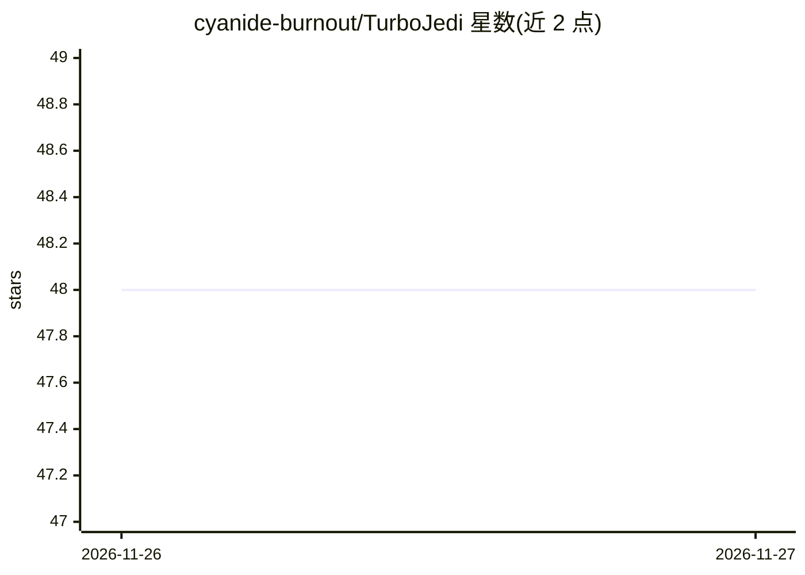

# cyanide-burnout/TurboJedi

⭐ 48 · C++ · MIT · 推送 2026-11-25 · [GitHub](https://github.com/cyanide-burnout/TurboJedi) · 个人维护

**终端里的 journald 日志查看器，带 LLM 解释与 MCP 接入**

基于 Turbo Vision 的 systemd journal TUI 查看器：多窗口各自持有过滤条件（unit、级别、正则、时间范围等），支持跟踪/暂停、时间线、高亮规则、书签、布局持久化与剪贴板导出。AI 部分双向工作：内置 Arrakis LLM 客户端解释选中的条目、窗口错误或书签并支持追问，可通过 OpenAI/Anthropic 兼容 API 使用 llama.cpp、Ollama、vLLM 等本地服务；另提供 turbojedi-mcp.py（MCP 服务器）把打开的窗口暴露给 Claude Code 等代理。可用 Lua 5.4 插件扩展，提供多发行版安装包与源码构建。

## 筛选速览

| 维度 | 判定 | 备注 |
|---|---|---|
| AI 角色 | `ai-enhanced` | 去掉 AI 部分产品仍成立 |
| 许可风险 | `permissive` | MIT |
| 部署形态 | `desktop` | 安装包/桌面程序 |
| 模型依赖 | local-ok | 支持本地模型 |
| 硬件要求 | — | 无带数字的原话,不猜 |
| 安装摩擦 | `medium` | 含编译或系统依赖之一 |
| 成熟度 | — | 结构信号不足 |

## 能力要点

- 多窗口独立过滤的 journald TUI 查看器，支持跟踪/暂停与时间线
- 内置 Arrakis LLM 客户端，解释条目/错误/书签并支持对话追问
- turbojedi-mcp.py MCP 服务器将窗口暴露给 Claude Code 等代理
- Lua 5.4 插件系统，条目动作与 journal 监视可扩展

## 适用场景

- 在终端中并排查看和过滤多个 systemd journal 窗口
- 让 LLM 解释日志错误并给出排查建议
- 通过 MCP 让 AI 代理定位屏幕上的日志条目
- 用 Lua 插件为日志条目添加自定义操作

## 场景标签

 · 领域:运维工具/日志分析

## 证据(README 行号)

> L3: Turbo Journald Interface (J[e]DI) — a TUI log viewer of the systemd journal (journald) in Turbo Vision, with AI-powe
> L13: - **TurboJedi asks a model itself.** Arrakis, a client of LLMs built in, explains the entries you mark, the errors 
> L18: - **An agent asks TurboJedi.** `turbojedi-mcp.py`, a server of the Model Context Protocol, gives Claude Code, Codex

## 星数曲线

2026-11-26 48 → 2026-11-27 48（+0）

---
*卡片 v1 · prompt 1.4 · 生成 2026-11-26 · 置信度 high · 依据 README sha `bd4a15b76603` · [字段定义](../../DATASET.md)*
