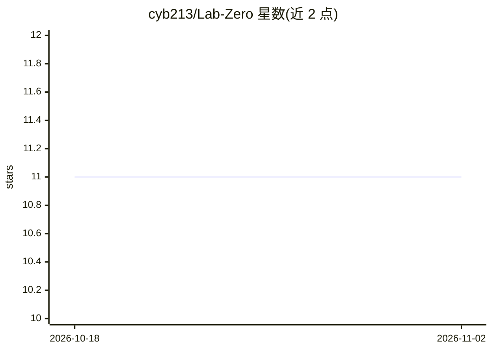

# cyb213/Lab-Zero

⭐ 11 · Shell · NOASSERTION · 推送 2026-09-26 · [GitHub](https://github.com/cyb213/Lab-Zero) · [官网](https://nikoloz.limon10.com/) · 个人维护

**给 Claude Code/Codex 加跨会话记忆的 clone-and-go 工作区**

面向使用 AI 编码 agent 的用户的工作区模板：克隆即用，内置语义召回引擎（首次运行下载约 100MB 嵌入模型，此后本地运行、无需 API key）、预置工作习惯与仪式命令（/kickoff、/new-project、/lab-plan 等），可将成熟想法一键迁移为独立项目工作区。默认适配 Claude Code（开箱即用），Codex 需额外一次性信任步骤，两者可共用同一工作区。需 Git 与 Python 3.9+；文件保护钩子为尽力而为，不拦截 shell 写入。

## 筛选速览

| 维度 | 判定 | 备注 |
|---|---|---|
| AI 角色 | `ai-ecosystem` | LLM/agent 周边工具 |
| 许可风险 | `none` | NOASSERTION |
| 部署形态 | `None` |  |
| 模型依赖 | locked-api |  |
| 硬件要求 | — | 无带数字的原话,不猜 |
| 安装摩擦 | `low` | 无编译、无系统依赖或容器化 |
| 成熟度 | — | 结构信号不足 |

## 能力要点

- 语义召回：回答前检索文档与自身记忆，本地运行无需 API key
- /kickoff → /new-project 一条命令将想法迁移为独立项目工作区
- 同时支持 Claude Code（开箱即用）与 Codex（需一次性 hook 信任）
- 内置文件保护钩子（尽力而为）与 update.sh 更新机制

## 适用场景

- 让编码 agent 跨会话记住项目决策与个人偏好
- 把想法从草稿孵化为结构化的独立项目
- 在同一工作区上切换使用 Claude Code 或 Codex

## 场景标签

`Agent 记忆` · 领域:Agent 开发

## 证据(README 行号)

> L5: Lab Zero is a ready-made setup for **Claude Code** (and Codex) that remembers your context across sessions, comes wi
> L117: - **Claude Code** is fully wired out of the box: the clone ships committed `.claude/` wiring, so the skills *and* 

## 星数曲线

2026-10-18 11 → 2026-11-02 11（+0）

---
*卡片 v1 · prompt 1.4 · 生成 2026-11-02 · 置信度 high · 依据 README sha `4f70c3fe324c` · [字段定义](../../DATASET.md)*
