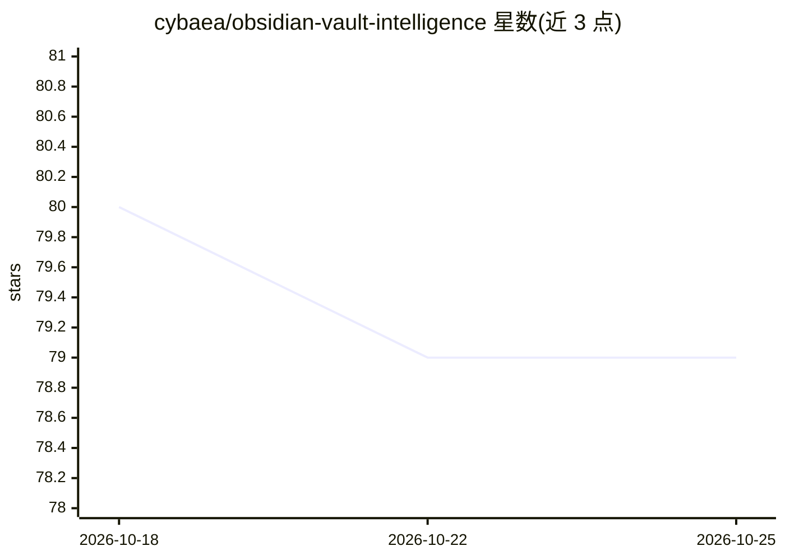

# cybaea/obsidian-vault-intelligence

⭐ 79 · TypeScript · MIT · 推送 2026-10-24 · [GitHub](https://github.com/cybaea/obsidian-vault-intelligence) · [官网](https://cybaea.github.io/obsidian-vault-intelligence/) · 组织维护

**Obsidian 知识库维护插件：用 AI agent 检索、更新与整理笔记**

面向 Obsidian 用户的 AI 插件，将笔记库转为自维护知识系统：Explorer 基于向量搜索与图谱连接做语义检索，Researcher 结合网络搜索起草笔记更新，Gardener 审计标签与链接并生成待审清单，Solver 在沙箱中执行 Python 分析表格数据。推理与嵌入可选 Google Gemini、Ollama、任意 OpenAI 兼容服务端或 Transformers.js 本地模型，可完全离线运行；支持 MCP 连接外部工具，写操作需用户批准。

## 筛选速览

| 维度 | 判定 | 备注 |
|---|---|---|
| AI 角色 | `ai-native` | 本体是模型或模型工具 |
| 许可风险 | `permissive` | MIT |
| 部署形态 | `None` |  |
| 模型依赖 | local-ok | 支持本地模型 |
| 硬件要求 | — | 无带数字的原话,不猜 |
| 安装摩擦 | `low` | 无编译、无系统依赖或容器化 |
| 成熟度 | — | 结构信号不足 |

## 能力要点

- Graph RAG 依据笔记间显式链接而非仅文本匹配检索上下文
- 四个 agent（Explorer/Researcher/Gardener/Solver）分工覆盖检索、更新、整理与数据分析
- Transformers.js 嵌入 + 本地 Ollama 模型可 100% 离线运行
- MCP 连接外部脚本/数据库，文件修改需人工批准

## 适用场景

- 让 AI 读旧笔记并联网检索新进展后起草更新
- 自动审计笔记标签与缺失链接，保持知识库结构一致
- 在 Obsidian 内用本地模型离线做语义问答

## 场景标签

`知识库管理` · 领域:知识与检索

## 证据(README 行号)

> L15: Vault Intelligence is a different AI plugin for Obsidian. It transforms your vault into a dynamic, self-maintaining
> L21: - Frontier or local — your choice: Reason with Google Gemini (the recommended default), Ollama (local or Ollama Clo

## 星数曲线

2026-10-18 80 → 2026-10-25 79（-1）

---
*卡片 v1 · prompt 1.4 · 生成 2026-10-24 · 置信度 high · 依据 README sha `128d583af137` · [字段定义](../../DATASET.md)*
