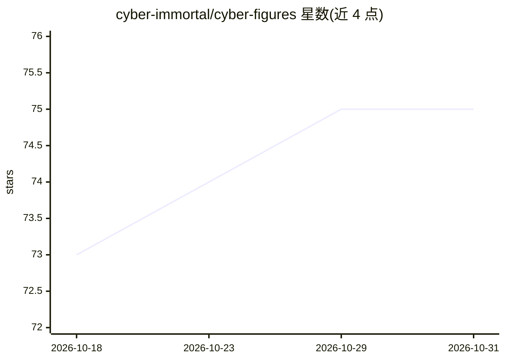

# cyber-immortal/cyber-figures

⭐ 75 · HTML · 推送 2026-04-10 · [GitHub](https://github.com/cyber-immortal/cyber-figures) · 个人维护 · 中文 README

**AI 人物蒸馏 Skill 库：把中国互联网人物还原成可用的 Claude Skill**

赛博人物库项目，将中国互联网人物的语言风格与判定框架蒸馏为 AI Skill 文件。已入库第二个角色「月老鳌烨」：基于 409 个抖音连麦视频、约 69 万字 SenseVoice 转录语料，产出 2700+ 行 SKILL.md，含三层身份模型、7 条核心公理、颜值打分系统（带反 LLM nice 倾向铁律）、12 个话题亚类话术库与 6 phase 连麦流程引擎。以 Claude Code Skill 形式安装，也可复制为 system prompt 用于其他 AI 工具。README 附明确的能做/不能做边界声明。

## 筛选速览

| 维度 | 判定 | 备注 |
|---|---|---|
| AI 角色 | `ai-native` | 本体是模型或模型工具 |
| 许可风险 | `none` | — |
| 部署形态 | `None` |  |
| 模型依赖 | — | README 未给出锁定关系 |
| 硬件要求 | — | 无带数字的原话,不猜 |
| 安装摩擦 | `low` | 无编译、无系统依赖或容器化 |
| 成熟度 | — | 结构信号不足 |

## 能力要点

- 409 个视频、69 万字一手语料的逐段扫描蒸馏
- 三层身份模型与 7 条核心公理构建角色框架
- 颜值打分系统含 6 条严格铁律（普通人=4 分中位数）
- 2700+ 行 SKILL.md，兼容 Claude Code 与任意自定义 prompt 工具

## 适用场景

- 在 Claude Code 中以鳌烨的框架做婚恋定位对话
- 用任意 AI 工具通过 system prompt 复现该人物风格
- 参考人物蒸馏方法论制作其他角色 Skill

## 场景标签

`提示工程` · 领域:Agent 开发

## 证据(README 行号)

> L205: 赛博人物库 — 把中国互联网最有辨识度的人物蒸馏成 AI Skill。
> L6:  Claude Code Skill

## 星数曲线

2026-10-18 73 → 2026-10-31 75（+2）

---
*卡片 v1 · prompt 1.4 · 生成 2026-10-24 · 置信度 high · 依据 README sha `2dd2da413e4a` · [字段定义](../../DATASET.md)*
