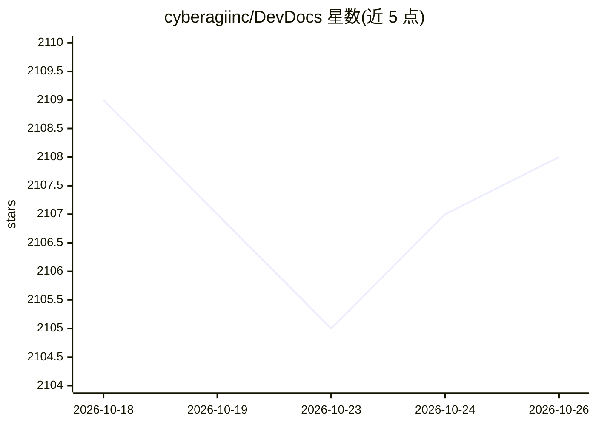

# cyberagiinc/DevDocs

⭐ 2,108 · TypeScript · Apache-2.0 · 推送 2026-02-04 · [GitHub](https://github.com/cyberagiinc/DevDocs) · [官网](https://www.cyberagi.ai) · 组织维护

**面向开发者的免费自托管技术文档爬取与 MCP 服务器**

由 CyberAGI 开发的文档爬取与检索平台：基于 Crawl4AI 对任意技术文档站点做深度可配置（1-5 级）的智能爬取，提取干净内容并以 Markdown/JSON 导出或组织进内置 MCP 服务器，供 Cursor、Windsurf、Cline、Roo Code、Claude Desktop 等 LLM 客户端查询。提供前端 UI、后端 API 与健康检查脚本，通过 Docker 一键部署（Windows 为实验性）。README 顶部声明该公开版本不再公开维护，内部增强版后续发布。

## 筛选速览

| 维度 | 判定 | 备注 |
|---|---|---|
| AI 角色 | `ai-ecosystem` | LLM/agent 周边工具 |
| 许可风险 | `permissive` | Apache-2.0 |
| 部署形态 | `None` |  |
| 模型依赖 | locked-api |  |
| 硬件要求 | — | 无带数字的原话,不猜 |
| 安装摩擦 | `low` | 无编译、无系统依赖或容器化 |
| 成熟度 | `idea` | |

## 能力要点

- 1-5 级深度智能爬取与子 URL 自动发现
- 内置 MCP 服务器，供 LLM 客户端查询文档内容
- 内容导出为 MD/JSON，可用于 LLM 微调
- Docker 一键部署，附启动与调试脚本集

## 适用场景

- 把某项技术的官方文档爬取后接入 Claude/Cline 等 MCP 客户端随时查询
- 将团队内部文档转成可被 LLM 检索的知识库
- 批量导出文档为 MD/JSON 用于模型微调数据

## 场景标签

`网页抓取` `文档问答` · 领域:效率与自动化

## 证据(README 行号)

> L74: DevDocs brings documentation to you. Point it at any tech documentation URL, and watch as it:
> L77: 3. Organizes information logically inside an MCP server ready for your LLM to query

## 星数曲线

2026-10-18 2,109 → 2026-10-26 2,108（-1）

---
*卡片 v1 · prompt 1.4 · 生成 2026-10-21 · 置信度 high · 依据 README sha `9b0f0417a58d` · [字段定义](../../DATASET.md)*
