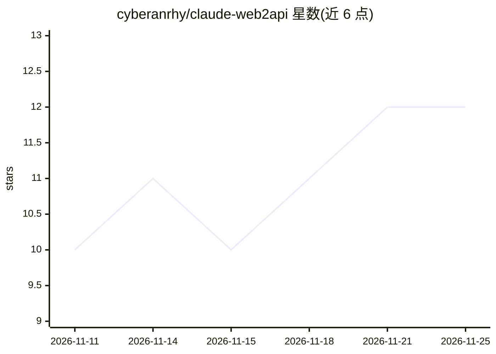

# cyberanrhy/claude-web2api

⭐ 12 · Python · 推送 2026-06-20 · [GitHub](https://github.com/cyberanrhy/claude-web2api) · 个人维护

**把 Claude.ai 网页转成 OpenAI 兼容 API 的自托管代理**

一个 Python 编写的代理服务器：将标准 /v1/chat/completions 请求转发到 Claude.ai 内部 API，通过 Firefox 导出的 cookie 鉴权（无需 API key），支持 SSE 流式与非流式输出、工具调用、429 限流处理与指数退避的 TLS 重试；使用 curl_cffi 模拟 Chrome 指纹绕过 Cloudflare。要求 Python 3.10+、cookies.txt 浏览器扩展及 VPN/代理（Claude.ai 屏蔽非住宅 IP），依赖 Claude.ai 免费额度的每日消息限制，每天 9:00 重置。

## 筛选速览

| 维度 | 判定 | 备注 |
|---|---|---|
| AI 角色 | `ai-ecosystem` | LLM/agent 周边工具 |
| 许可风险 | `none` | — |
| 部署形态 | `library` | 以包/库形式分发 |
| 模型依赖 | locked-api |  |
| 硬件要求 | — | 无带数字的原话,不猜 |
| 安装摩擦 | `low` | 无编译、无系统依赖或容器化 |
| 成熟度 | — | 结构信号不足 |

## 能力要点

- OpenAI 兼容 /v1/chat/completions 接口，支持 SSE 流式与工具调用
- cookie 鉴权，无需 API key
- curl_cffi Chrome 指纹模拟绕过 Cloudflare
- 自动 TLS 重试与 429 日额度重置处理

## 适用场景

- 本地开发调试时通过 OpenAI 兼容接口调用 Claude.ai
- 把 Claude.ai 接入仅支持 OpenAI API 格式的工具
- 自动化脚本中复用 Claude.ai 网页会话

## 场景标签

`模型网关` · 领域:Agent 开发

## 证据(README 行号)

> L5: OpenAI-compatible proxy for Claude.ai Web API.
> L7: Converts standard `/v1/chat/completions` requests to Claude.ai internal API. Works via cookie-based auth — no API ke
> L13: - OpenAI-compatible `/v1/chat/completions`

## 星数曲线

2026-11-11 10 → 2026-11-25 12（+2）

---
*卡片 v1 · prompt 1.4 · 生成 2026-11-18 · 置信度 high · 依据 README sha `3adb4cbf3124` · [字段定义](../../DATASET.md)*
