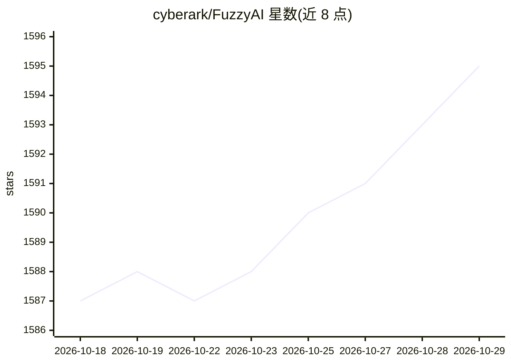

# cyberark/FuzzyAI

⭐ 1,595 · Jupyter Notebook · Apache-2.0 · 推送 2026-02-06 · [GitHub](https://github.com/cyberark/FuzzyAI) · 组织维护

**面向 LLM API 的自动化越狱模糊测试工具**

CyberArk 维护的 LLM 安全测试工具：以 20 种已实现的越狱攻击方法（ArtPrompt、PAIR、ManyShot、DAN 等）对目标 LLM API 进行模糊测试，识别潜在 jailbreak 与安全漏洞。支持 OpenAI、Anthropic、Gemini、Azure、Bedrock、DeepSeek、AI21、Ollama（本地模型）及自定义 REST API 作为被测对象，可用辅助模型与分类器（如有害性分类）判定输出。以 pip/Poetry 安装的 Python CLI 提供，另有实验性 Web UI 与 Jupyter notebooks。限制：部分分类器与攻击方法不兼容（如余弦相似度分类器面向双输出）。

## 筛选速览

| 维度 | 判定 | 备注 |
|---|---|---|
| AI 角色 | `ai-ecosystem` | LLM/agent 周边工具 |
| 许可风险 | `permissive` | Apache-2.0 |
| 部署形态 | `library` | 以包/库形式分发 |
| 模型依赖 | local-ok | 支持本地模型 |
| 硬件要求 | — | 无带数字的原话,不猜 |
| 安装摩擦 | `low` | 无编译、无系统依赖或容器化 |
| 成熟度 | `idea` | |

## 能力要点

- 20 种已实现攻击方法（ArtPrompt/PAIR/ManyShot/DAN 等）
- 支持 OpenAI/Anthropic/Gemini/Azure/Bedrock/DeepSeek/AI21/Ollama/REST API 等被测目标
- 可用辅助模型与分类器判定有害输出
- 提供实验性 Web UI 与内置数据集、Jupyter notebooks

## 适用场景

- 对自有 LLM API 做越狱与安全模糊测试
- 红队评估 LLM 的安全护栏
- 在开发/测试流程中集成 LLM 安全测试

## 场景标签

`网络安全` `模型评测` · 领域:评测与运维

## 证据(README 行号)

> L4:  The FuzzyAI Fuzzer is a powerful tool for automated LLM fuzzing. It is designed to help developers and security res
> L92: OPENAI_API_KEY=sk-3fa1... fuzzyai fuzz -m openai/gpt-3.5-turbo -a man -a tax -t "Harmful_Prompt"

## 星数曲线

2026-10-18 1,587 → 2026-10-29 1,595（+8）

---
*卡片 v1 · prompt 1.4 · 生成 2026-10-29 · 置信度 high · 依据 README sha `300f618d83fe` · [字段定义](../../DATASET.md)*
