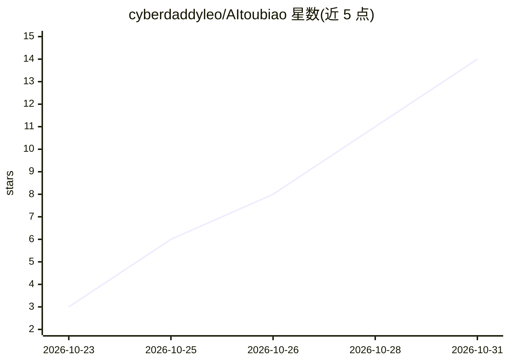

# cyberdaddyleo/AItoubiao

⭐ 14 · Python · 推送 2026-10-17 · [GitHub](https://github.com/cyberdaddyleo/AItoubiao) · 个人维护 · 中文 README

**面向企业的政府采购投标全流程管理系统，AI 起草标书技术方案**

覆盖找标→读标→写标→防废标→管投标→复盘的系统：定时采集中国政府采购网等公告，按订阅画像与企业资料库匹配标讯并判定能投/不能投；解析招标文件的资格要求与废标条款；按目录自动搭标书框架、格式文件自动填写、技术方案由 AI 起草并对照评分点补全；交标前合规体检提示常见废标风险。多主体、六种角色权限，支持企业微信/钉钉/飞书推送。采集、匹配、体检、导出等核心功能不依赖 AI（L88），配置 AI 后启用解读、深度解析与方案起草。提供 Mac/Windows 本机版与 Docker 部署；Docker 镜像与真实大模型接入尚未验证（L147-148）。

## 筛选速览

| 维度 | 判定 | 备注 |
|---|---|---|
| AI 角色 | `ai-enhanced` | 去掉 AI 部分产品仍成立 |
| 许可风险 | `none` | — |
| 部署形态 | `self-host` | docker 或自建部署 |
| 模型依赖 | local-ok | 支持本地模型 |
| 硬件要求 | — | 无带数字的原话,不猜 |
| 安装摩擦 | `low` | 无编译、无系统依赖或容器化 |
| 成熟度 | `idea` | |

## 能力要点

- 定时增量采集政府采购公告并按订阅画像打分匹配
- 标书自动组装：格式文件按资料库填写，证书/业绩只引用真实条目
- 交标前合规体检含串标风险、★条款响应等风险提示
- AI 仅依据招标文件原文与资料库素材写作，无依据数字标【待补充】

## 适用场景

- 每天自动收到匹配企业资质的招标标讯推送
- 上传招标文件后生成投标准备清单与标书草稿
- 交标前做合规体检排查废标风险

## 场景标签

`AI 写作` `网页抓取` `工作流自动化` · 领域:效率与自动化

## 证据(README 行号)

> L3: 帮企业每天自动找到「自己能投、值得投」的标，用 AI 把公司已有的真实资料按甲方要求组装成标书，并把投标全过程管起来。
> L88: 不配置 AI 也能用：采集、规则匹配、规则解析、格式文件、资料引用、合规体检、导出都不依赖 AI。

## 星数曲线

2026-10-23 3 → 2026-10-31 14（+11）

---
*卡片 v1 · prompt 1.4 · 生成 2026-10-31 · 置信度 mid · 依据 README sha `0e91fd7df8ed` · [字段定义](../../DATASET.md)*
