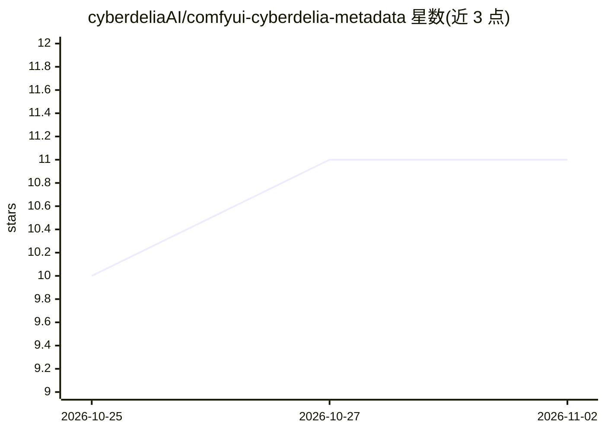

# cyberdeliaAI/comfyui-cyberdelia-metadata

⭐ 11 · Python · GPL-3.0 · 推送 2026-10-13 · [GitHub](https://github.com/cyberdeliaAI/comfyui-cyberdelia-metadata) · 组织维护

**ComfyUI 图像保存节点：写入 Civitai 兼容的 PNG/JPG/WebP 元数据**

ComfyUI 自定义节点扩展，替换原生 Save Image 节点后，将 seed、模型、LoRA、提示词与采样器设置等结构化元数据写入 PNG/JPG/WebP 文件，格式兼容 Civitai 上传自动读取。面向使用复杂条件链、多采样器工作流的 ComfyUI 用户。内建约 20 个第三方节点包的图遍历适配，提供运行时文本捕获 hook API、文件名/子目录模板与五种元数据范围。经 ComfyUI-Manager 或 git clone 安装，是 nkchocoai 包的直系继任者，带工作流迁移脚本。

## 筛选速览

| 维度 | 判定 | 备注 |
|---|---|---|
| AI 角色 | `ai-ecosystem` | LLM/agent 周边工具 |
| 许可风险 | `viral` | GPL-3.0 |
| 部署形态 | `None` |  |
| 模型依赖 | — | README 未给出锁定关系 |
| 硬件要求 | — | 无带数字的原话,不猜 |
| 安装摩擦 | `low` | 无编译、无系统依赖或容器化 |
| 成熟度 | — | 结构信号不足 |

## 能力要点

- Civitai 兼容元数据写入 PNG/JPG/WebP
- 复杂条件链与多采样器工作流下的正确 prompt/采样器归因
- 约 20 个第三方节点包开箱支持（rgthree、efficiency-nodes、RES4LYF 等）
- 运行时文本捕获 hook API 与文件名/子目录模板（%seed%、%model% 等）

## 适用场景

- 上传 Civitai 时自动带回 seed、模型、LoRA 与提示词信息
- 复杂 ComfyUI 工作流中保存准确的生成参数元数据
- 批量迁移旧工作流到版本 2 的唯一节点 id

## 场景标签

 · 领域:图像生成/工作流工具

## 证据(README 行号)

> L8: Civitai-compatible image metadata for ComfyUI, with robust handling of complex conditioning chains and modern multi-
> L132: Replace your `Save Image` node with **Save Image With Metadata (Cyberdelia)**.

## 星数曲线

2026-10-25 10 → 2026-11-02 11（+1）

---
*卡片 v1 · prompt 1.4 · 生成 2026-11-02 · 置信度 high · 依据 README sha `47710a027145` · [字段定义](../../DATASET.md)*
