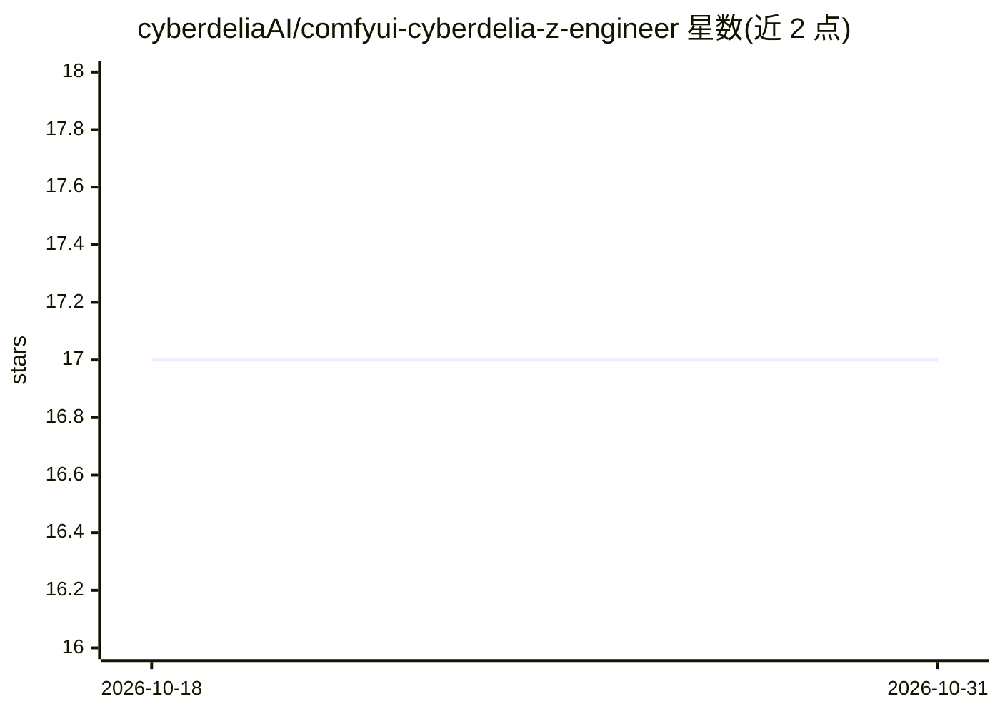

# cyberdeliaAI/comfyui-cyberdelia-z-engineer

⭐ 17 · Python · MIT · 推送 2026-10-30 · [GitHub](https://github.com/cyberdeliaAI/comfyui-cyberdelia-z-engineer) · 组织维护

**ComfyUI 的 LLM 提示词工程节点：自动生成/改写图像提示词**

Cyberdelia AI Lab 开发的 ComfyUI 自定义节点包，通过 LM Studio、Ollama 等 OpenAI 兼容服务端用 LLM 生成图像提示词。提供 Text、Conditioning（直接 CLIP 编码）、Chain（多系统提示链）、Danbooru Prompt（自然语言转验证过的 booru 标签，含 14 万标签本地词表）与 Wildcard Prompts（模板随机/顺序填充，用于 LoRA 测试）等节点；支持图像转提示词的视觉输入、LM Studio 模型自动发现、Bearer 鉴权与重试。需在 ComfyUI 环境内运行。

## 筛选速览

| 维度 | 判定 | 备注 |
|---|---|---|
| AI 角色 | `ai-ecosystem` | LLM/agent 周边工具 |
| 许可风险 | `permissive` | MIT |
| 部署形态 | `library` | 以包/库形式分发 |
| 模型依赖 | local-ok | 支持本地模型 |
| 硬件要求 | — | 无带数字的原话,不猜 |
| 安装摩擦 | `low` | 无编译、无系统依赖或容器化 |
| 成熟度 | — | 结构信号不足 |

## 能力要点

- LLM 生成文本/视觉提示词，兼容任意 OpenAI 兼容服务端
- Danbooru 节点含 14 万标签本地词表并验证排序
- Wildcard 模板支持随机选择、顺序执行与每提示完整工作流
- 输出清洗、错误处理与瞬时失败重试

## 适用场景

- 在 ComfyUI 工作流中用 LLM 自动改写或扩展图像提示词
- 为 booru 标签训练的动漫模型生成规范 Danbooru 标签
- LoRA 测试时批量生成随机/顺序提示词

## 场景标签

`提示工程` `图像生成` · 领域:Agent 开发

## 证据(README 行号)

> L8: Model-independent text, vision, wildcard, and Danbooru prompt engineering for ComfyUI. Generate a reusable prompt st
> L18: Cyberdelia Prompt Engineer sends text, or an optional image plus instructions, to LM Studio, Ollama, or another Ope

## 星数曲线

2026-10-18 17 → 2026-10-31 17（+0）

---
*卡片 v1 · prompt 1.4 · 生成 2026-10-29 · 置信度 high · 依据 README sha `ebddacc0adea` · [字段定义](../../DATASET.md)*
