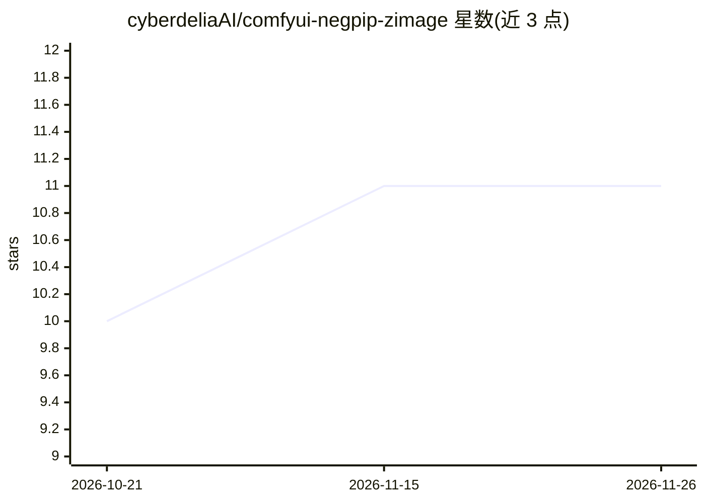

# cyberdeliaAI/comfyui-negpip-zimage

⭐ 11 · Python · AGPL-3.0 · 推送 2026-11-03 · [GitHub](https://github.com/cyberdeliaAI/comfyui-negpip-zimage) · [官网](https://cyberdelia.nl/) · 组织维护

**ComfyUI 单节点：为多模型提供 NegPiP 负向提示词加权**

一个独立的 ComfyUI 自定义节点，实现 NegPiP 负向提示词加权。节点连接在模型与 CLIP 加载器之后，将独立输入的正向与负向文本字符串编译为负权重条件，输出修补后的模型与条件给常规采样工作流。支持 Z-Image/Turbo、Krea 2、MOSS-Image/Turbo（实验性）、SD1、SDXL 与 Anima，Flux 不支持。安装只需 git clone 到 custom_nodes 并重启 ComfyUI，无需额外 Python 包。兼容性与使用注意事项按模型分节说明。

## 筛选速览

| 维度 | 判定 | 备注 |
|---|---|---|
| AI 角色 | `ai-ecosystem` | LLM/agent 周边工具 |
| 许可风险 | `viral` | AGPL-3.0 |
| 部署形态 | `None` |  |
| 模型依赖 | — | README 未给出锁定关系 |
| 硬件要求 | — | 无带数字的原话,不猜 |
| 安装摩擦 | `low` | 无编译、无系统依赖或容器化 |
| 成熟度 | — | 结构信号不足 |

## 能力要点

- 负向文本自动编译为 NegPiP 负权重（如 (text:1.3)→(text:-1.3)）
- 支持 Z-Image/Turbo、Krea 2、MOSS、SD1/SDXL、Anima 多架构
- 与 ComfyUI-ppm 可共存，节点 ID 与 1.x 工作流向后兼容
- 带 unittest 开发测试（MOSS 路径用 CPU 张量测试）

## 适用场景

- 在 ComfyUI 图像生成流程中消除背景模糊、水印、文字等负向概念
- 按分组概念以不同强度细化负向提示词控制
- Z-Image Turbo 的 CFG 1 工作流中不增加负向扩散 passes

## 场景标签

`图像生成` · 领域:内容生成

## 证据(README 行号)

> L8: A standalone, single-node NegPiP implementation for **Z-Image**, **Z-Image
> L11: returns the conditioning required by a normal ComfyUI sampling workflow.
> L194: |Z-Image / Z-Image Turbo|Supported|Lumina2 / NextDiT / Qwen3-4B|

## 星数曲线

2026-10-21 10 → 2026-11-26 11（+1）

---
*卡片 v1 · prompt 1.4 · 生成 2026-11-18 · 置信度 high · 依据 README sha `af7db0169abf` · [字段定义](../../DATASET.md)*
