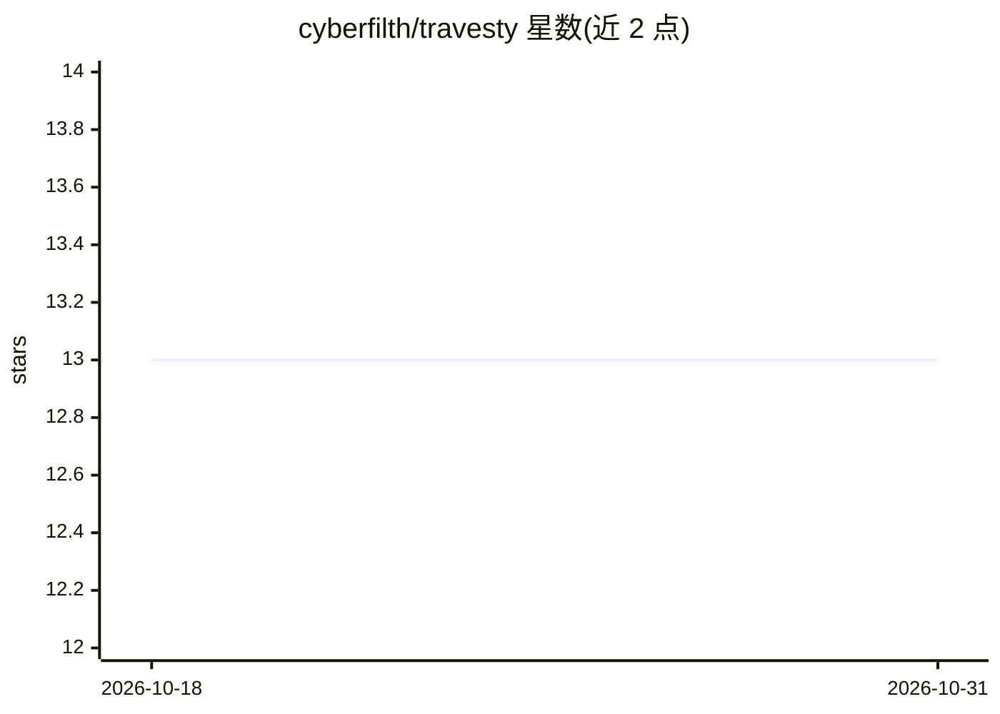

# cyberfilth/travesty

⭐ 13 · Pascal · 推送 2025-11-24 · [GitHub](https://github.com/cyberfilth/travesty) · 个人维护

**基于 Markov 链的戏仿文本生成器，1984 BYTE 算法的 GUI 复刻**

复刻 Hugh Kenner 与 Joseph O'Rourke 于 1984 年在 BYTE 杂志发表的 Travesty 文本扰乱算法：按 Markov 链方式打乱/重组输入文本生成戏仿文本，代码基本保留原版，另加了 GUI 便于调参，并附带《爱丽丝梦游仙境》文本。提供 Windows 二进制文件于 Releases 页面。以 FreePascal/Lazarus 编写。

## 筛选速览

| 维度 | 判定 | 备注 |
|---|---|---|
| AI 角色 | `ai-native` | 本体是模型或模型工具 |
| 许可风险 | `none` | — |
| 部署形态 | `desktop` | 安装包/桌面程序 |
| 模型依赖 | — | README 未给出锁定关系 |
| 硬件要求 | — | 无带数字的原话,不猜 |
| 安装摩擦 | `low` | 无编译、无系统依赖或容器化 |
| 成熟度 | — | 结构信号不足 |

## 能力要点

- 复刻 1984 BYTE 杂志的 Travesty 文本扰乱算法
- 提供 GUI 便于调整选项
- 附带 Alice in Wonderland 示例文本

## 适用场景

- 生成打乱重组的戏仿文本用于娱乐或实验
- 体验 1984 年经典 Markov 链文本生成算法

## 场景标签

`AI 写作` · 领域:内容生成

## 证据(README 行号)

> L2: ## A parody text generator
> L6: Literary critic Hugh Kenner and computer scientist Joseph O'Rourke introduced their text scrambler "Travesty" in an 

## 星数曲线

2026-10-18 13 → 2026-10-31 13（+0）

---
*卡片 v1 · prompt 1.4 · 生成 2026-10-31 · 置信度 high · 依据 README sha `11b8054578e5` · [字段定义](../../DATASET.md)*
