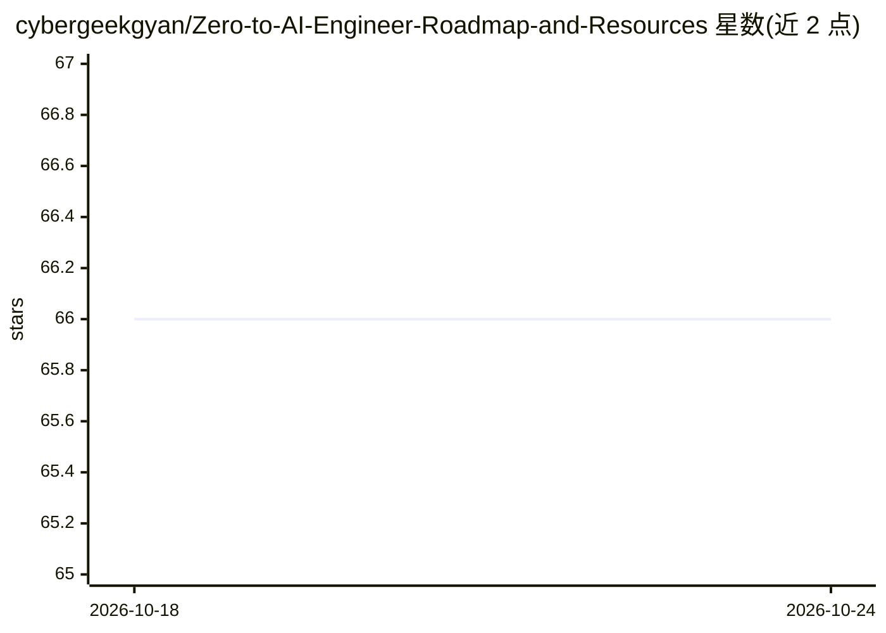

# cybergeekgyan/Zero-to-AI-Engineer-Roadmap-and-Resources

⭐ 66 · 推送 2026-03-10 · [GitHub](https://github.com/cybergeekgyan/Zero-to-AI-Engineer-Roadmap-and-Resources) · [官网](https://cybergeekgyan.github.io/Zero-to-AI-Engineer-Roadmap-and-Resources/) · 个人维护

**AI 工程师成长路线图与资源清单，覆盖基础到面试**

面向立志成为 AI 工程师的学习者的策展路线图：从线性代数、概率统计、信息论等数学基础，到 Linux/Python/SQL 等计算机基础，再到数据分析、数据工程（ETL、Spark、Airflow、Kafka、云平台）、大数据技术、机器学习与深度学习主题，最后收录实践项目与 AI 工程师岗位面试准备资源。内容以分类清单形式组织，不提供软件安装或运行方式。

## 筛选速览

| 维度 | 判定 | 备注 |
|---|---|---|
| AI 角色 | `ai-knowledge` | 知识聚合/清单类 |
| 许可风险 | `none` | — |
| 部署形态 | `None` |  |
| 模型依赖 | — | README 未给出锁定关系 |
| 硬件要求 | — | 无带数字的原话,不猜 |
| 安装摩擦 | `low` | 无编译、无系统依赖或容器化 |
| 成熟度 | — | 结构信号不足 |

## 能力要点

- 覆盖数学基础、计算机基础、数据概念、AI 主题四层的结构化路线图
- 收录数据工程工具链（Spark、Airflow、Kafka、dbt、云平台等）条目
- 包含 300+ 数据科学实践项目与面试准备章节

## 适用场景

- 按路线图系统学习 AI 工程师所需知识
- 查找数据工程与分析工具的学习条目
- 为 AI 工程师岗位面试做准备

## 场景标签

`精选清单` `教程课程` · 领域:学习与行业

## 证据(README 行号)

> L3: A comprehensive roadmap and curated resources for aspiring AI Engineers, covering foundational knowledge, core AI co
> L93: ### 🟢 DeepAI Topics & Concepts
> L122: ## Interview Preparation for AI Engineer Roles

## 星数曲线

2026-10-18 66 → 2026-10-24 66（+0）

---
*卡片 v1 · prompt 1.4 · 生成 2026-10-24 · 置信度 high · 依据 README sha `2ae60cbd7c9d` · [字段定义](../../DATASET.md)*
