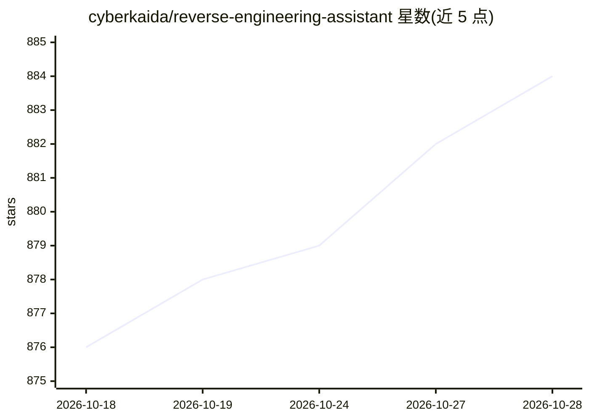

# cyberkaida/reverse-engineering-assistant

⭐ 884 · Java · Apache-2.0 · 推送 2026-10-27 · [GitHub](https://github.com/cyberkaida/reverse-engineering-assistant) · 个人维护

**让 AI 通过 MCP 调用 Ghidra 做逆向分析的扩展**

Ghidra 扩展，内置 Model Context Protocol (MCP) 服务器，使 AI 语言模型能够访问 Ghidra 的逆向工程能力。采用工具驱动方式，为 LLM 提供一组小工具，通过 schema、输入容错、附带命名空间与交叉引用等额外上下文来降低幻觉与上下文占用，支持大型二进制与固件镜像分析。提供两种使用模式：assistant 模式连接运行中的 Ghidra UI 做交互分析，headless 模式无 UI 运行，适用于 CI/CD 与容器化流程。仅支持 Ghidra 12.0 及以上，推荐客户端为 Claude Code。安装方式包括下载 release 扩展包、gradle 源码构建或 uv 安装命令行工具。

## 筛选速览

| 维度 | 判定 | 备注 |
|---|---|---|
| AI 角色 | `ai-ecosystem` | LLM/agent 周边工具 |
| 许可风险 | `permissive` | Apache-2.0 |
| 部署形态 | `desktop` | 安装包/桌面程序 |
| 模型依赖 | — | README 未给出锁定关系 |
| 硬件要求 | — | 无带数字的原话,不猜 |
| 安装摩擦 | `low` | 无编译、无系统依赖或容器化 |
| 成熟度 | — | 结构信号不足 |

## 能力要点

- MCP 服务器形式向 LLM 提供一组小工具（含 schema 与输入容错）
- 工具输出附带命名空间、交叉引用等上下文以减少幻觉与上下文占用
- assistant 模式（连接 Ghidra UI）与 headless 模式（CI/CD、Docker、PyGhidra）双模式
- 可与其他 MCP 服务器（如 GitHub、Kagi）组合扩展分析能力

## 适用场景

- 让 AI 辅助分析二进制、重命名变量、修正数据类型
- 在 CI/CD 或容器中自动化逆向分析流程
- 解 CTF 题目并生成 pwntools 脚本、撰写加密分析报告

## 场景标签

`网络安全` · 领域:学习与行业

## 证据(README 行号)

> L3: > A Ghidra extension that provides a Model Context Protocol (MCP) server for AI-assisted reverse engineering
> L5: ReVa (Reverse Engineering Assistant) is a **Ghidra MCP server** that enables AI language models to interact with Ghi
> L33: As an MCP server, ReVa can be used alongside other MCP servers to enrich its analysis.

## 星数曲线

2026-10-18 876 → 2026-10-28 884（+8）

---
*卡片 v1 · prompt 1.4 · 生成 2026-10-21 · 置信度 high · 依据 README sha `3fb6707aa5a2` · [字段定义](../../DATASET.md)*
