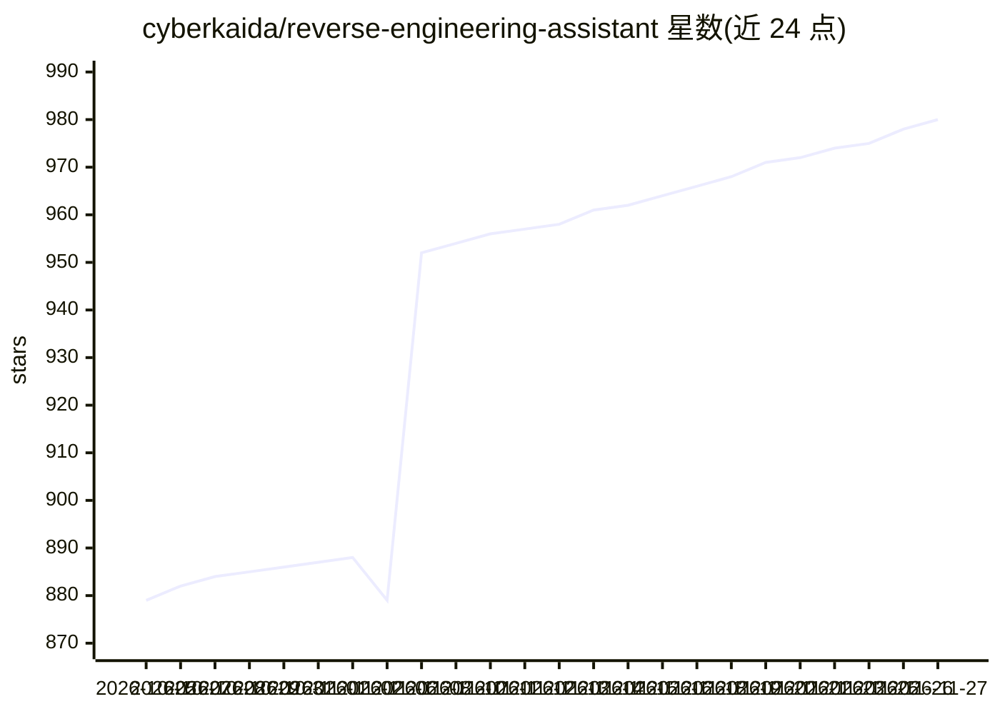

# cyberkaida/reverse-engineering-assistant

⭐ 980 · Java · Apache-2.0 · 推送 2026-11-23 · [GitHub](https://github.com/cyberkaida/reverse-engineering-assistant) · 个人维护

**给 Ghidra 加 MCP 服务器的逆向工程 AI 助手扩展**

ReVa 是一个 Ghidra 扩展，通过 Model Context Protocol 让 AI 语言模型调用 Ghidra 的逆向分析能力。采用工具驱动设计：为 LLM 提供多个小型工具，带 schema 与容错输入、返回小片段并附带命名空间与交叉引用等上下文，以降低幻觉和上下文占用，支持大型二进制与固件镜像。支持 assistant 模式（连接运行中的 Ghidra UI）与 headless 模式（自动化、CI/CD、Docker）。需 Ghidra 12.0+ 与对应 Java 版本，经 Ghidra 扩展管理器安装或 gradle 构建。

## 筛选速览

| 维度 | 判定 | 备注 |
|---|---|---|
| AI 角色 | `ai-native` | 本体是模型或模型工具 |
| 许可风险 | `permissive` | Apache-2.0 |
| 部署形态 | `desktop` | 安装包/桌面程序 |
| 模型依赖 | — | README 未给出锁定关系 |
| 硬件要求 | — | 无带数字的原话,不猜 |
| 安装摩擦 | `medium` | 含编译或系统依赖之一 |
| 成熟度 | — | 结构信号不足 |

## 能力要点

- 为 LLM 提供小型工具集，schema 容错与纠错回传以降低幻觉
- assistant 与 headless 双模式，headless 适配自动化与 CI/CD
- 可与其他 MCP 服务器组合（GitHub 源码、Kagi 网络搜索）
- 附带 Claude Code 插件市场：Binary Triage、密码分析、CTF 技能

## 适用场景

- 分析二进制中字符串、加密使用点并生成 markdown 报告
- CTF 题目中让 AI 分析程序并生成 pwntools 脚本
- 在流水线中对二进制做自动化导入与差异分析
- 让 AI 边分析边重命名变量并总结程序功能

## 场景标签

`编码 Agent` `网络安全` · 领域:编码与开发

## 证据(README 行号)

> L3: > A Ghidra extension that provides a Model Context Protocol (MCP) server for AI-assisted reverse engineering
> L5: ReVa (Reverse Engineering Assistant) is a **Ghidra MCP server** that enables AI language models to interact with Ghi
> L79: There are two ways to use ReVa, with the Ghidra UI in assistant mode or in headless mode. Headless mode is ideal fo

## 星数曲线

2026-10-25 879 → 2026-11-27 980（+101）

---
*卡片 v1 · prompt 1.4 · 生成 2026-11-24 · 置信度 high · 依据 README sha `54027796c132` · [字段定义](../../DATASET.md)*
