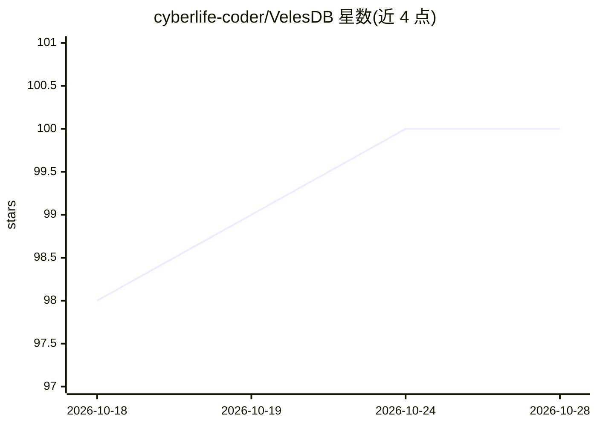

# cyberlife-coder/VelesDB

⭐ 100 · Rust · NOASSERTION · 推送 2026-10-27 · [GitHub](https://github.com/cyberlife-coder/VelesDB) · [官网](https://velesdb.com) · 个人维护

**面向 AI agent 的本地一体化记忆引擎：向量+图+列存**

单一二进制同时提供向量检索（HNSW）、图查询（原生 MATCH 子句）与列式过滤，以 VelesQL 统一查询；核心机制包括：why() 沿类型化链接回溯证据路径、无 LLM 的确定性上下文编译器（compile_context，按 token 预算压缩并记录每片段决策）、持久化 MemoryService。本地优先：记忆路径无云端、无 API key。安装途径覆盖 pip、cargo、npm、Docker、WASM 浏览器端；通过 MCP server 接入 Claude Code、Codex CLI 等客户端，支持 Ollama 作为可选语义嵌入后端。默认嵌入器为确定性 hash（词法而非语义），语义召回需自行配置。

## 筛选速览

| 维度 | 判定 | 备注 |
|---|---|---|
| AI 角色 | `ai-ecosystem` | LLM/agent 周边工具 |
| 许可风险 | `none` | NOASSERTION |
| 部署形态 | `self-host` | docker 或自建部署 |
| 模型依赖 | local-ok | 支持本地模型 |
| 硬件要求 | — | 无带数字的原话,不猜 |
| 安装摩擦 | `low` | 无编译、无系统依赖或容器化 |
| 成熟度 | — | 结构信号不足 |

## 能力要点

- 向量+图+列存三引擎融合于单一查询语言
- why() 沿类型化链接返回召回的证据路径，跨会话可用
- 确定性上下文编译器：无 LLM、无网络，82.5% 输入 token 节省有 committed harness
- 提供 MCP memory server、Claude Code hooks、共享守护进程与多客户端接入

## 适用场景

- 给编程 agent 配置可审计的持久记忆，跨会话保留决策原因
- 在 token 预算内压缩 agent 累积上下文以降低账单开销
- 本地部署兼具语义检索与关系查询的数据库，数据不出机器

## 场景标签

`向量数据库` `Agent 记忆` · 领域:Agent 开发

## 证据(README 行号)

> L35: cargo install velesdb-memory                                    # the local MCP memory server
> L129: Agents burn most of their budget re-reading redundant context. `compile_context` / `compile_transcript` (MCP, or `

## 星数曲线

2026-10-18 98 → 2026-10-28 100（+2）

---
*卡片 v1 · prompt 1.4 · 生成 2026-10-23 · 置信度 high · 依据 README sha `82baacb19f2a` · [字段定义](../../DATASET.md)*
