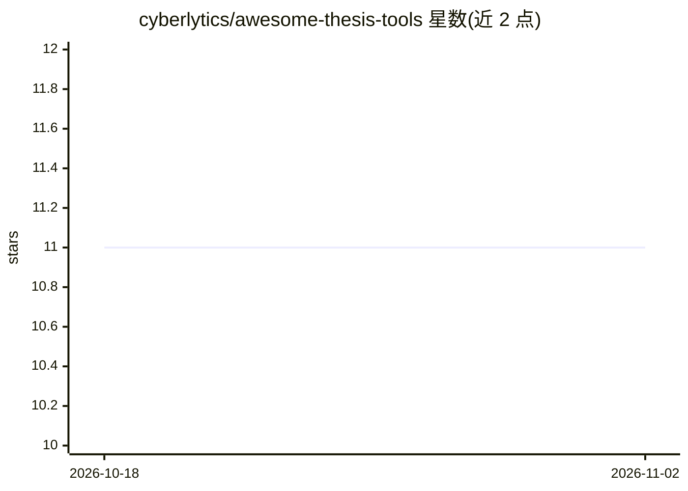

# cyberlytics/awesome-thesis-tools

⭐ 11 · CC-BY-4.0 · 推送 2026-10-19 · [GitHub](https://github.com/cyberlytics/awesome-thesis-tools) · 个人维护

**面向计算机/AI专业学生的毕业论文资源与工具清单**

德语编写的毕业论文写作资源合集：覆盖学术写作基础（评分标准、IMRaD、引用规范）、LaTeX/BibTeX/Word 工具链、学术出版（会议/期刊投稿）、文献检索（Google Scholar、DBLP 等）以及 Shell、Docker、Git 等工程技能教程。条目以免费资源为主，面向学生和个人使用；由 OTH Amberg-Weiden 背景的维护者整理，并注明生成式 AI 在毕业论文中的使用政策限制。

## 筛选速览

| 维度 | 判定 | 备注 |
|---|---|---|
| AI 角色 | `ai-knowledge` | 知识聚合/清单类 |
| 许可风险 | `viral` | CC-BY-4.0 |
| 部署形态 | `desktop` | 安装包/桌面程序 |
| 模型依赖 | — | README 未给出锁定关系 |
| 硬件要求 | — | 无带数字的原话,不猜 |
| 安装摩擦 | `low` | 无编译、无系统依赖或容器化 |
| 成熟度 | — | 结构信号不足 |

## 能力要点

- 覆盖写作方法、LaTeX、引用规范与投稿流程的学术资源条目
- 包含文献检索引擎与替代方案列表（Scholar/DBLP/Scopus 等）
- 附工程技能教程（PowerShell/WSL/Docker/Git/Markdown）
- 明确面向学生与个人使用，付费工具多为范围外

## 适用场景

- 我写计算机/AI毕业论文需要写作方法与文献检索入门资源
- 查找 LaTeX 与 BibTeX 的教程和常见错误指南
- 了解学术出版渠道与作者身份/学术规范要求

## 场景标签

`精选清单` `科研工具` · 领域:学习与行业

## 证据(README 行号)

> L9: Dies ist ein digitaler Ressourcen-Pool für Abschlussarbeiten in der Informatik/KI (kostenlose Lernmaterialien) sowie
> L157: ## Literaturrecherche & Wissensaufbau

## 星数曲线

2026-10-18 11 → 2026-11-02 11（+0）

---
*卡片 v1 · prompt 1.4 · 生成 2026-11-02 · 置信度 mid · 依据 README sha `674d19951ce0` · [字段定义](../../DATASET.md)*
