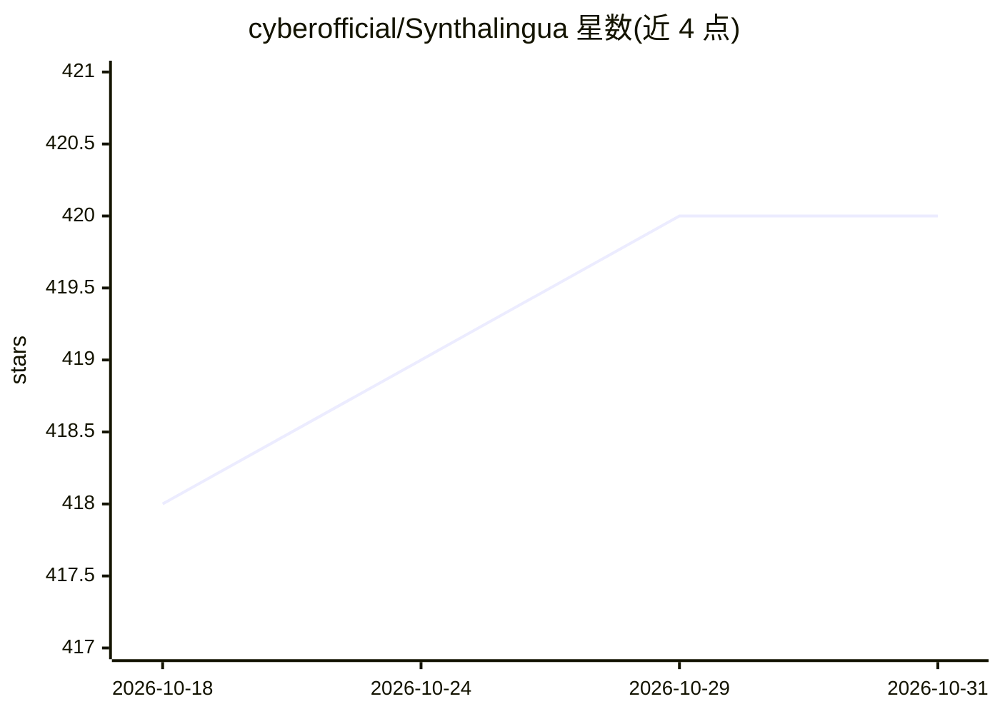

# cyberofficial/Synthalingua

⭐ 420 · Python · AGPL-3.0 · 推送 2026-10-16 · [GitHub](https://github.com/cyberofficial/Synthalingua) · [官网](https://x.com/SynthalinguaGH) · 个人维护

**自托管的近实时语音翻译与转录工具（直播/麦克风/文件）**

在本地运行的 AI 音频翻译工具：从 HLS 直播流（YouTube、Twitch 等）、麦克风或音视频文件读取音频，用 Whisper/FasterWhisper/OpenVINO 模型完成转录与翻译，支持数十种语言互译。提供网页版视频播放器界面（同步字幕、SRT/VTT 导出）、浏览器实时字幕服务器与 Discord 推送，并带重复短语抑制与自动屏蔽列表。安装需 Python 3.12、FFmpeg 与 Git，运行 setup 脚本；GPU 加速可选（NVIDIA CUDA/AMD ROCm/Intel NPU），README 自述处于 beta 阶段。

## 筛选速览

| 维度 | 判定 | 备注 |
|---|---|---|
| AI 角色 | `ai-native` | 本体是模型或模型工具 |
| 许可风险 | `viral` | AGPL-3.0 |
| 部署形态 | `library` | 以包/库形式分发 |
| 模型依赖 | — | README 未给出锁定关系 |
| 硬件要求 | `gpu-8g` | |
| 安装摩擦 | `medium` | 含编译或系统依赖之一 |
| 成熟度 | `idea` | |

## 能力要点

- 直播流/麦克风/文件三种输入的近实时翻译与转录
- 网页视频播放器 UI：同步字幕、字幕样式自定义、SRT/VTT 导出
- Whisper、FasterWhisper、OpenVINO 三种模型来源，CPU/CUDA/Intel iGPU/dGPU/NPU 设备选择
- 重复与幻觉短语抑制、自动屏蔽列表、Discord 与网页输出

## 适用场景

- 实时观看外语直播并看母语字幕
- 为本地音视频文件生成翻译字幕
- 练习外语时听懂外语媒体内容

## 场景标签

`语音识别` · 领域:感知与多模态

## 证据(README 行号)

> L21: - **Real-time translation & transcription** (stream, mic, file)
> L130: - **Flexible input**: Microphone, HLS stream, or file

## 星数曲线

2026-10-18 418 → 2026-10-31 420（+2）

---
*卡片 v1 · prompt 1.4 · 生成 2026-10-21 · 置信度 mid · 依据 README sha `c6f04099e39f` · [字段定义](../../DATASET.md)*
