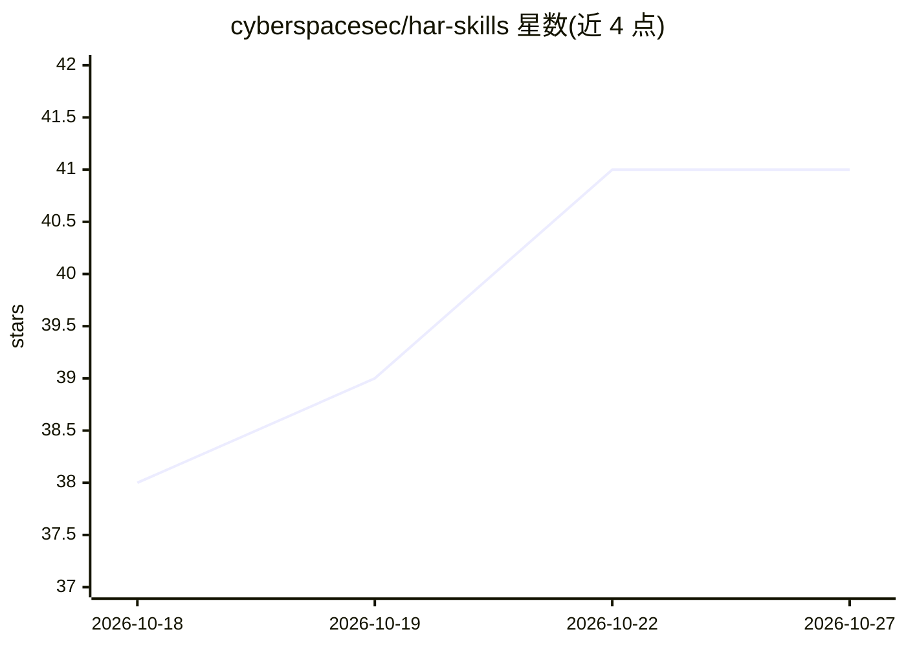

# cyberspacesec/har-skills

⭐ 41 · Go · MIT · 推送 2026-07-20 · [GitHub](https://github.com/cyberspacesec/har-skills) · 组织维护 · 中文 README

**面向 AI Agent 的 HAR 文件分析工具集，含 CLI 与 Go SDK**

AI 优先设计的 HAR（HTTP Archive）分析工具：以 CLAUDE.md 技能文档、24 个命令的 `har` CLI、可嵌入的 Go SDK 三种方式供 Agent 与开发者访问，另规划 MCP 服务器。能力覆盖 HAR 解析（含 gzip、流式、懒加载）、搜索过滤、安全审计（响应头/Cookie/CORS/混合内容）、Lighthouse 风格性能评分、敏感信息脱敏、请求重放、diff/merge/split 及导出为 curl、Postman、CSV、JSON 等格式。提供 go install、预编译二进制与源码构建三种安装途径。

## 筛选速览

| 维度 | 判定 | 备注 |
|---|---|---|
| AI 角色 | `ai-ecosystem` | LLM/agent 周边工具 |
| 许可风险 | `permissive` | MIT |
| 部署形态 | `library` | 以包/库形式分发 |
| 模型依赖 | — | README 未给出锁定关系 |
| 硬件要求 | — | 无带数字的原话,不猜 |
| 安装摩擦 | `low` | 无编译、无系统依赖或容器化 |
| 成熟度 | — | 结构信号不足 |

## 能力要点

- 24 个 CLI 命令覆盖解析、检索、安全审计、性能评分、脱敏、重放、对比与导出
- CLAUDE.md 渐进式披露技能文档 + CLI + Go SDK 三种 Agent 接入方式，MCP 服务器为规划中
- 支持 gzip、标准/优化/懒加载/流式四种大文件解析模型
- 导出格式包括 curl、wget、Python、Postman、CSV、Markdown、HTML、JSON、JSONL、YAML、XML

## 适用场景

- 让 Claude/编码类 Agent 用一条命令分析 HAR 抓包文件
- 排查网页加载失败与慢请求，输出 JSON 供模型阅读
- 分享抓包前用 redact 移除密码、令牌、API key 等敏感数据
- 对比前后两次抓包、生成 curl 复现命令用于回归测试

## 场景标签

`网络安全` · 领域:学习与行业

## 证据(README 行号)

> L9: **HAR Skills is an AI-native HAR (HTTP Archive) analysis toolkit.**
> L11: It is designed for AI agents first, then exposed as a Go SDK and CLI. An agent can install one binary, inspect a HA
> L44: |**AI Agent Skill**|Ready|Claude, ChatGPT, coding agents, local automation|CLAUDE.md + `har` CLI|

## 星数曲线

2026-10-18 38 → 2026-10-27 41（+3）

---
*卡片 v1 · prompt 1.4 · 生成 2026-10-25 · 置信度 high · 依据 README sha `ca45f0a31851` · [字段定义](../../DATASET.md)*
