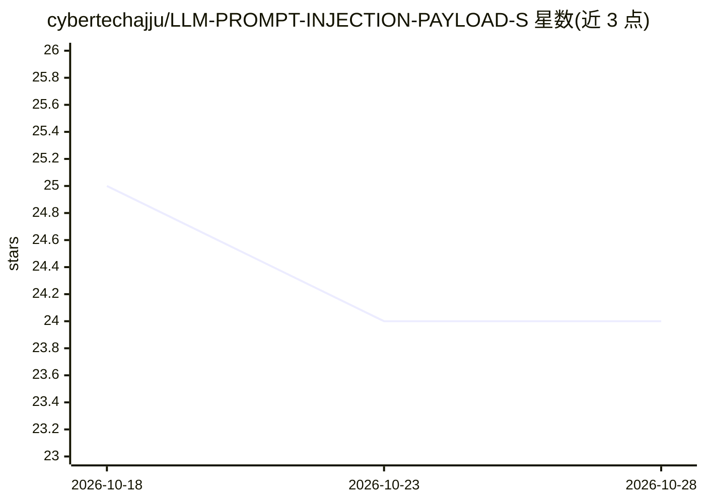

# cybertechajju/LLM-PROMPT-INJECTION-PAYLOAD-S

⭐ 24 · 推送 2025-11-23 · [GitHub](https://github.com/cybertechajju/LLM-PROMPT-INJECTION-PAYLOAD-S) · [官网](https://youtu.be/DZHgmuB-N1I?si=Z67S_cLEwcdnoZ9W) · 个人维护

**面向道德黑客与 AI 红队的提示注入教学与测试指南**

以纯 README 形式呈现的提示词实验室指南：提供侦察、分析、报告三类模块化提示词包，通过粘贴提示、人工观察模型行为的方式开展授权环境下的 AI 安全测试。不含 CLI、git 或工具依赖，浏览器与手动步骤即可使用；附五步流程（确定范围、加载基线安全提示、执行测试、记录、报告）、报告模板与伦理边界（仅限授权环境、不发布可利用载荷）。面向学生、漏洞赏金猎人与培训者。

## 筛选速览

| 维度 | 判定 | 备注 |
|---|---|---|
| AI 角色 | `ai-knowledge` | 知识聚合/清单类 |
| 许可风险 | `none` | — |
| 部署形态 | `None` |  |
| 模型依赖 | — | README 未给出锁定关系 |
| 硬件要求 | — | 无带数字的原话,不猜 |
| 安装摩擦 | `low` | 无编译、无系统依赖或容器化 |
| 成熟度 | — | 结构信号不足 |

## 能力要点

- 模块化提示词包：recon、analysis、reporting 三类
- 纯 README 形式，零工具依赖，浏览器/手动步骤即可
- 五步测试流程与报告就绪模板（Test case/Prompt/Response/Risk/Mitigation）
- 内置伦理边界与安全护栏（仅授权环境、防御导向报告）

## 适用场景

- 在授权实验环境中学习 AI 提示注入安全测试
- bug bounty 或红队培训中做可复现的演示
- 按模板记录并防御导向地报告模型行为测试结果

## 场景标签

`网络安全` `教程课程` · 领域:学习与行业

## 证据(README 行号)

> L16: An emoji-rich, markup-only guide to run your “Secret Prompt” lab — no CLI or git required.
> L30: - 🧩 Modular prompt packs: recon, analysis, reporting

## 星数曲线

2026-10-18 25 → 2026-10-28 24（-1）

---
*卡片 v1 · prompt 1.4 · 生成 2026-10-27 · 置信度 high · 依据 README sha `0f1a828bb799` · [字段定义](../../DATASET.md)*
