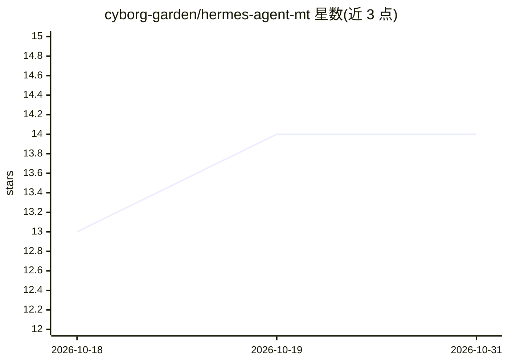

# cyborg-garden/hermes-agent-mt

⭐ 14 · Python · MIT · 推送 2026-10-27 · [GitHub](https://github.com/cyborg-garden/hermes-agent-mt) · [官网](https://nimbleco.ai) · 组织维护 · 中文 README

**多租户自学习 AI 代理：跨消息平台对话并自主积累技能**

Nous Research hermes-agent 的多租户分支，增加按上下文隔离的记忆、群组策略与 Swarm Map 集成。本体为终端用户可对话的自改进代理：内置学习循环（从经验创建技能、使用中改进、跨会话记忆与 FTS5 会话搜索），通过单一网关进程接入 Telegram/Discord/Slack/WhatsApp/Signal，支持 40+ 工具、MCP 集成、cron 定时任务与七种终端后端（本地/Docker/SSH/Modal 等）。模型可切换 Nous Portal、OpenRouter、OpenAI 等。提供 curl/PowerShell 一键安装脚本与 GHCR 镜像；CI 发布路径随组织更名已变更，旧镜像冻结。

## 筛选速览

| 维度 | 判定 | 备注 |
|---|---|---|
| AI 角色 | `ai-native` | 本体是模型或模型工具 |
| 许可风险 | `permissive` | MIT |
| 部署形态 | `desktop` | 安装包/桌面程序 |
| 模型依赖 | — | README 未给出锁定关系 |
| 硬件要求 | — | 无带数字的原话,不猜 |
| 安装摩擦 | `medium` | 含编译或系统依赖之一 |
| 成熟度 | — | 结构信号不足 |

## 能力要点

- 内置学习循环：技能创建、使用中自我改进、跨会话记忆与 FTS5 会话搜索
- 单一网关接入 Telegram/Discord/Slack/WhatsApp/Signal/Email 多平台
- 七种终端后端（本地/Docker/SSH/Singularity/Modal/Daytona/Vercel Sandbox）
- 多租户补丁：按上下文记忆隔离、群组策略执行、Swarm Map 集成

## 适用场景

- 在手机消息平台上与云端运行的 AI 代理持续对话协作
- 让代理通过定时任务自动执行日报、备份等无人值守工作
- 多用户共用一个代理实例且各自记忆相互隔离

## 场景标签

`聊天机器人` `Agent 记忆` · 领域:Agent 开发

## 证据(README 行号)

> L21: **The self-improving AI agent built by Nous Research.** It's the only agent with a built-in learning loop — it crea
> L5: > **🔀 Multi-Tenant Fork** — This is `hermes-agent-mt`, patched for multi-tenant deployments with per-context memory 
> L26:  Lives where you do Telegram, Discord, Slack, WhatsApp, Signal, and CLI — all from a single gateway process. Voice 

## 星数曲线

2026-10-18 13 → 2026-10-31 14（+1）

---
*卡片 v1 · prompt 1.4 · 生成 2026-10-31 · 置信度 high · 依据 README sha `c8df5c853f36` · [字段定义](../../DATASET.md)*
