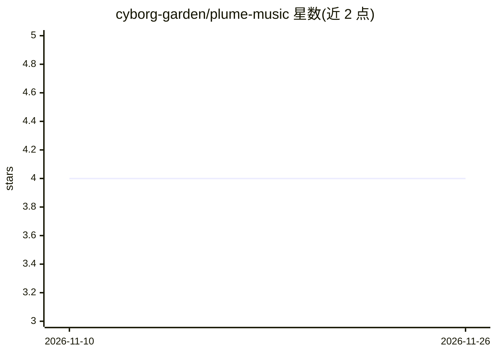

# cyborg-garden/plume-music

⭐ 4 · Python · AGPL-3.0 · 推送 2026-11-21 · [GitHub](https://github.com/cyborg-garden/plume-music) · 个人维护

**随你演奏的 AI 伴奏乐队 CLI：从提示词生成可编辑乐谱**

一个 Python CLI 工具：给定提示词（风格、BPM、段落）后生成人类可读、可修改、可确定性渲染的编曲，会话以 JSON 乐谱存储，每个命令支持 --json，render 与 analyze 让 agent 无需音箱、DAW 或 GPU 即可听到自己的产出。实时模式下通过麦克风/乐器监听你的节拍，在乐句边界切入合奏（sideman/lead 两种模式），带延迟校准、决策日志与会话管理。音频合成基于 NumPy DSP 与开放采样库。作者注明仅在 macOS 单台设备上试过实时声音。

## 筛选速览

| 维度 | 判定 | 备注 |
|---|---|---|
| AI 角色 | `ai-native` | 本体是模型或模型工具 |
| 许可风险 | `viral` | AGPL-3.0 |
| 部署形态 | `library` | 以包/库形式分发 |
| 模型依赖 | — | README 未给出锁定关系 |
| 硬件要求 | — | 无带数字的原话,不猜 |
| 安装摩擦 | `low` | 无编译、无系统依赖或容器化 |
| 成熟度 | `idea` | |

## 能力要点

- 提示词生成可读、可改、确定性渲染的编曲（JSON 乐谱 + --json 命令）
- 实时合奏：听拍后在乐句边界切入，支持 lead/sideman 角色互换
- 针对房间的延迟校准与可读的 NDJSON 决策日志
- 纯 NumPy DSP 合成音色，无需 DAW/GPU，支持 agent 驱动

## 适用场景

- 用提示词快速产出可编辑的节拍/编曲草稿并渲染成音频
- 与机器即兴合奏，让它跟随你的节拍与乐句
- 让编码 agent 通过 CLI 自作曲、自渲染、自分析

## 场景标签

 · 领域:音乐/创意工具

## 证据(README 行号)

> L6: **Play music with your machine.** Give plume a prompt ("chill trap beat over lofi
> L12: It is built for language models as much as for people. The CLI is the instrument, a
> L13: session is a JSON score, every command speaks `--json`, and `render` plus `analyze` let

## 星数曲线

2026-11-10 4 → 2026-11-26 4（+0）

---
*卡片 v1 · prompt 1.4 · 生成 2026-11-21 · 置信度 high · 依据 README sha `3dbb89d256c1` · [字段定义](../../DATASET.md)*
