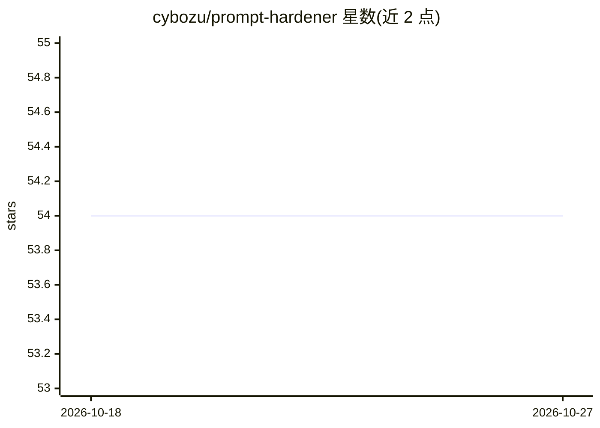

# cybozu/prompt-hardener

⭐ 54 · Python · Apache-2.0 · 推送 2026-09-01 · [GitHub](https://github.com/cybozu/prompt-hardener) · 组织维护

**面向 LLM 应用的提示注入风险静态分析与加固 CLI 工具**

Prompt Hardener 是 cybozu 开发的安全工具，用于分析 LLM agent 与应用中的提示注入风险。用户在 agent_spec.yaml 中描述系统（chatbot/RAG/agent/MCP agent 四类），运行确定性静态分析检查 prompt、tool、架构三层风险，生成修复建议（含 spotlighting、instruction_defense 等五种加固技术），并通过 LLM 驱动的对抗攻击模拟验证防御，结果可导出 Markdown/HTML/JSON。init/validate/analyze/report/diff 命令无需 LLM API key；remediate 与 simulate 需要调用 OpenAI、Anthropic Claude 或 AWS Bedrock。另提供本地 Gradio Web UI 与 CI 友好输出。

## 筛选速览

| 维度 | 判定 | 备注 |
|---|---|---|
| AI 角色 | `ai-ecosystem` | LLM/agent 周边工具 |
| 许可风险 | `permissive` | Apache-2.0 |
| 部署形态 | `library` | 以包/库形式分发 |
| 模型依赖 | locked-api |  |
| 硬件要求 | — | 无带数字的原话,不猜 |
| 安装摩擦 | `low` | 无编译、无系统依赖或容器化 |
| 成熟度 | — | 结构信号不足 |

## 能力要点

- 单一 agent_spec.yaml 驱动的确定性安全分析（init→validate→analyze→remediate→simulate→report→diff）
- 支持 chatbot/RAG/tool-calling agent/MCP agent 四类 agent 类型
- 内置对抗攻击模拟与五种提示层加固技术
- 核心命令无需 LLM API key，提供 Gradio Web UI

## 适用场景

- 为我的 LLM agent 做提示注入风险的静态分析
- 对系统提示生成加固建议并对比加固前后差异
- 在 CI 中导出安全分析报告
- 用对抗攻击场景验证防御措施是否有效

## 场景标签

`网络安全` · 领域:学习与行业

## 证据(README 行号)

> L3: Prompt Hardener analyzes **prompt-injection risk in LLM-based agents and applications**.
> L8: - run deterministic security analysis across prompt, tool, and architecture layers
> L18: - **Deterministic first**: `init`, `validate`, `analyze`, `report`, and `diff` do not require an LLM API key
> L113: Prompt Hardener supports these providers for LLM-backed commands:

## 星数曲线

2026-10-18 54 → 2026-10-27 54（+0）

---
*卡片 v1 · prompt 1.4 · 生成 2026-10-24 · 置信度 high · 依据 README sha `9edbe79e0944` · [字段定义](../../DATASET.md)*
