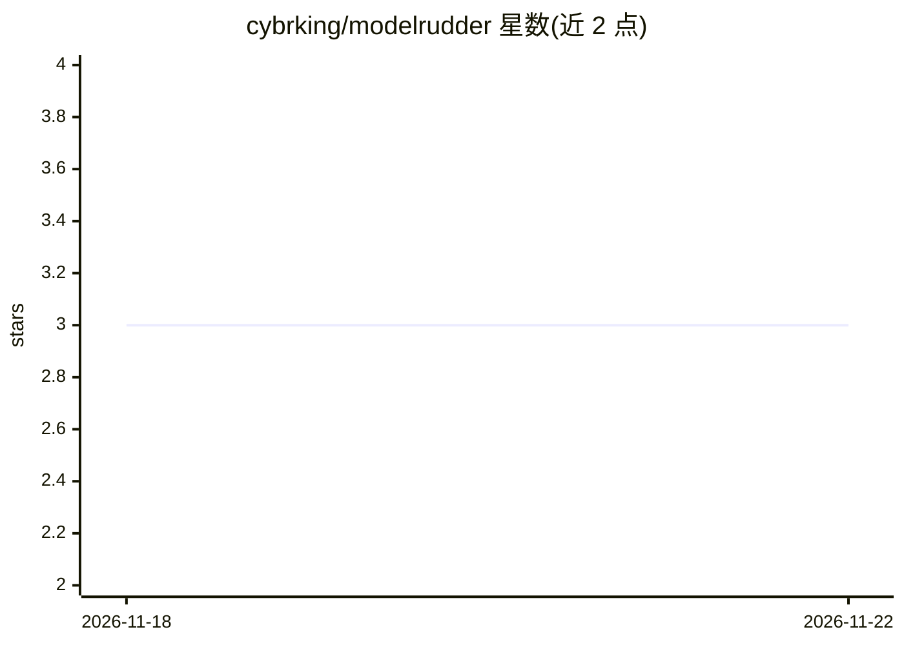

# cybrking/modelrudder

⭐ 3 · TypeScript · MIT · 推送 2026-10-28 · [GitHub](https://github.com/cybrking/modelrudder) · 个人维护

**为 Codex CLI 与 Claude Code 提供任务级模型选型建议的本地路由器**

以启动器形式运行于 macOS 的本地工具：包装原生 Codex/Claude Code CLI，调用 TypeSafe Jev 分类器按当前任务推荐可能更合适的模型，用户自行决定是否切换；模型控制权、审批与登录保留在原生工具中。0.1.0-preview.15 起从自动路由改为建议模式，历史路由与托管原生工作流仅作为恢复路径保留。需 Node.js 24+ 与用户自备的官方 CLI 账号，推荐功能需 Jev key 并显式开启分类同意；Linux/Windows 尚未提供。

## 筛选速览

| 维度 | 判定 | 备注 |
|---|---|---|
| AI 角色 | `ai-ecosystem` | LLM/agent 周边工具 |
| 许可风险 | `permissive` | MIT |
| 部署形态 | `None` |  |
| 模型依赖 | — | README 未给出锁定关系 |
| 硬件要求 | — | 无带数字的原话,不猜 |
| 安装摩擦 | `low` | 无编译、无系统依赖或容器化 |
| 成熟度 | `idea` | |

## 能力要点

- smart-codex/smart-claude 启动器在 PATH 上运行原生 CLI，不接管执行中继或模型改写
- recommend 命令按任务给出模型建议；无建议或分类不可用时静默
- Codex 支持 UserPromptSubmit 原生 hook 提示，Claude 走显式命令
- 推荐仅发送当前任务文本，不读取仓库文件、转录或历史轮次

## 适用场景

- 使用 Codex CLI 时想知道当前任务是否更适合另一个模型
- 在保留原生认证与权限的前提下获得模型切换提示
- 本地隐私敏感场景下做最小化数据流的任务分类

## 场景标签

 · 领域:开发者工具/LLM 基础设施

## 证据(README 行号)

> L5: Get a note when a different model may fit your task. You decide whether to switch; your coding tool keeps control of
> L15: |Codex|`smart-codex`|Native prompt-hook note when configured and trusted; explicit `recommend` command also availab
> L18: Both launchers run your native CLI on PATH. They do not start ModelRudder's execution relay, routing bridge or mode

## 星数曲线

2026-11-18 3 → 2026-11-22 3（+0）

---
*卡片 v1 · prompt 1.4 · 生成 2026-11-22 · 置信度 high · 依据 README sha `36d796bdaf16` · [字段定义](../../DATASET.md)*
